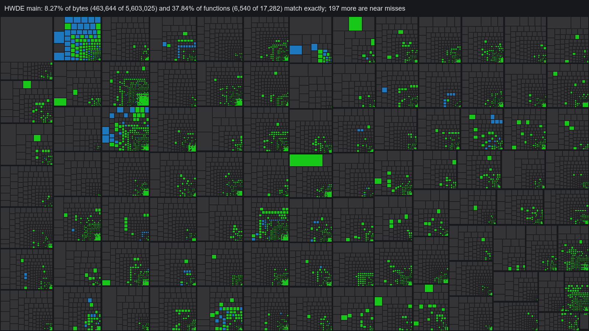

# Matching decompilation

<!-- progress -->


8.27% of bytes (463,644 of 5,603,025) and 37.84% of functions (6,540 of 17,282) match exactly; 197 more are near misses. Green: exact match, blue: near miss, grey: not done; one rectangle per function, sized by bytes, grouped into 64 KB address blocks.
<!-- /progress -->

Byte-for-byte matching work for update 1.0.1 `main`. The behavior-equivalent reconstruction in `src/` stays untouched and serves as the semantic reference. See `handoff/MATCHING_HANDOFF.md` for the plan and `docs/toolchain.md` for compiler hashes.

## Layout

| Path | Contents |
| --- | --- |
| `data/units.json` | Compiler, flags, original addresses of external symbols, and per unit the functions and file-static variables with their original addresses |
| `data/functions.csv` | All 17,276 baseline inventory entries: `Address,Quality,Size,Name`, quality `O` match, `m` minor, `M` major, `U` undecompiled, `L` library |
| `include/`, `src/` | Matching C++ by subsystem |
| `tools/check.py` | Compiles units and compares them; `--update` writes results to `functions.csv`; `--diff` prints instruction diffs |
| `tools/check_obj.py` | Compares one object file; also usable directly for experiments |
| `tools/seed_functions.py` | Regenerates `functions.csv` from `functions.tsv`, keeping recorded results |
| `build/` | Objects (not committed) |

```
python -B -I matching/tools/check.py --diff            # every unit
python -B -I matching/tools/check.py event/demo_sequence.cpp
python -B -I matching/tools/check.py --update          # record results
```

A function matches only when its compiled size equals the inventory size and every word is equal after relocations are resolved. The checker applies ADRP, ADD/LDST lo12 and B/BL relocations against the original addresses of: functions of every unit; the symbols in `units.json`; and file-static variables (found through their section-relative relocations). GOT relocations and unknown targets are masked and listed as unresolved.

## Compiler and flags

Clang 3.9.1 with:

```
-O3 -g -mcpu=cortex-a57+fp+simd+crypto+crc -mno-implicit-float -stdlib=libc++ -fPIC -fstandalone-debug --target=aarch64-linux-elf -std=c++14 -fno-strict-aliasing -fno-exceptions -mllvm -regalloc=greedy
```

The last two flags are not in the BotW/SMO set. Koei Tecmo built this game, so its flags can differ.
- `-fno-strict-aliasing`: needed for `2173c4`. Without it, the loop keeps the point-array pointer in a register instead of reloading it, and the two arguments swap registers.
- `-fno-exceptions`: the destructor `217070` is identical to `clear` (`2170fc`). With exceptions enabled, it gains a `__clang_call_terminate` landing pad.
- `-mllvm -regalloc=greedy`: greedy is already the default allocator, so allocation doesn't change. Naming an allocator explicitly makes Clang 3.9 skip its Cortex-A57 FP load-balancing pass (`AArch64A57FPLoadBalancing`, added only with the default allocator). That pass renames FP registers in multiply chains, which lets the load/store pairer merge stores the original keeps separate (`25cb98`). No earlier match changes.

Clang 4.0.1 fails three of the leaf queue functions; Clang 3.8.1 fails 7 of the 14 functions (see `docs/toolchain.md`).

## Results

6,550 of 6,747 attempted functions match: 6,540 inventory functions (463,644 bytes) plus 10 bodies outside the baseline inventory: the worker trampoline `45df64`, the static initializers `25aa0c` and `258970`, the array destructor `258944`, the queue worker entry points `2599ac`/`2599c4`, the gate thunk `25a174`, the cache worker callbacks `25b218`/`25b25c` and the empty `TrackResources::update` (`25cd50`). The other 197 are near misses, all `m`.

| Address | Function | Status |
| --- | --- | --- |
| `217054` | `DemoSequence::initialize` | match |
| `217060` | `DemoSequence::empty_operation` | match |
| `217064` | `DemoSequence::DemoSequence(DemoOwner*)` | match |
| `217070` | `DemoSequence::~DemoSequence` | match |
| `2170fc` | `DemoSequence::clear` | match |
| `217188` | `DemoSequence::load(void*)` | match |
| `217294` | `DemoSequence::sample` | `m`: registers of `n` and the scan index swapped (w10/w11); 65 of 76 words equal |
| `2173c4` | `DemoSequenceItem::load` | match |
| `2174d0` | `DemoSequenceItem::release` | match |
| `2581d4`, `258210` | `lookup_table_a`, `lookup_table_b` | match |
| `258240` | `demo_player_target` | match |
| `258280` | `demo_player_target_state` | match: the mode test is a `switch` on modes 7, 8, 9, 10 and 12 (gives the `ccmp`) |
| `25834c` | `demo_speed_scale` | match: same `switch` |
| `25839c` | `demo_player_pair` | match |
| `2583bc` | `demo_player_name` | `m`: ours tail-calls `copy_name`; the original makes a normal call with a frame. `3ff70` is not a string copy (it does float math on `[x1+8]`), so the name is a placeholder |
| `2583e0`–`258458` | `demo_player_value180/184/188` | match |
| `258494` | `demo_tuning_vector` | match |
| `2586bc` | `apply_demo_tuning` | match |
| `258760`–`2587cc` | `demo_tuning_nop`, `apply_demo_limit`, `query_game_state`, `demo_overrides_zero` | match |
| `2587d4`, `258824` | `create_frame_heap`, `destroy_frame_heap` | match |
| `25886c`, `258900` | `FrameHeap::initialize`, `finalize` | match |
| `258944`, `258970` | array destructor and static initializer of the queue workers (outside the inventory) | match |
| `2589b4` | `resource_queue_active` | match |
| `2589d0` | `cancel_resource_queue` | match |
| `258a68` | `finish_resource_queue` | match |
| `258b0c` | `register_resource_callback` | `m`: the first callback load is scheduled after the two flag stores instead of before (7 words) |
| `258c64` | `process_resource_queue` | `m`: registers of the running count and registry base swapped (w9/w10), plus scheduling in the write-back loops; 328 words vs 326 |
| `25917c` | `remove_resource_callback` | match |
| `259260` | `update_resource_queue` | `m`: one word; the `flag2` test is `cbz` instead of `tbz #0` |
| `259680` | `resource_queue_has_callback` | match |
| `2599dc` | `shutdown_resource_queue` | match |
| `259aec` | `resource_busy` | `m`: the rematerialized `result = 1` is placed one instruction later (3 words) |
| `259e44` | `set_resource_waiting` | match |
| `2598c4` | `initialize_resource_queue` | match |
| `2599ac`, `2599c4` | `run_resource_queue_worker`, `run_resource_queue_high_worker` (static) | match |
| `259e84`–`259e90` | `ChunkedData::set`, `nop`, `size` | match |
| `259ea8` | `ChunkedData::extract` | `m`: `from_allocator` is set inside the allocator branch (gives the original's `cset`); the original still re-checks the scratch pointer after the loop. 111 words vs 114 |
| `25a070` | `ChunkedData::extract_allocated` | match |
| `25a0d8` | `initialize_resource_system` | match |
| `25a134` | `shutdown_resource_system` | match |
| `25a174` | `set_resource_system_gate` | match |
| `25b0c0` | `initialize_resource_cache` | match |
| `25b120` | `shutdown_resource_cache` | match |
| `25b180` | `ResourceCache::stop` | match |
| `25b218`, `25b25c` | `run_resource_cache_read`, `run_resource_cache_direct` | match |
| `25b2a0` | `ResourceCache::start` | match |
| `25970c` | `resource_queue_callback_state` | match |
| `2597a8` | `resource_queue_callback_in_state` | match |
| `25984c` | `resource_queue_callback_count` | match |
| `25b394` | `ResourceFrame::ResourceFrame` | match |
| `25b3ac` | `ResourceFrame::~ResourceFrame` | match |
| `25b40c` | `ResourceFrame::close` | match |
| `25b46c` | `ResourceFrame::is_open` | match |
| `25b47c` | `ResourceFrame::bind` | match |
| `25b390` | first body of the resource-frame unit (empty; placeholder name) | match |
| `25b4b4` | `ResourceFrame::open` | match |
| `25b5b8` | `ResourceFrame::open_table` | match |
| `25b6f8` | `ResourceFrame::count` | match |
| `25b704` | `ResourceFrame::entry_offset` | match |
| `25b71c` | `ResourceFrame::entry_size` | match |
| `25b738` | `ResourceFrame::lookup` | match |
| `25b754` | `ResourceFrame::load` | `m`: the order of one `cset`/`csel` pair (4 words) |
| `25a178` | `resource_size` | match |
| `25a1ac` | `resource_read` | match |
| `25a1ec` | `resource_free` | match |
| `25a248`–`25a258` | `ResourceName` constructor, destructor, `finish`, `set` | match |
| `25a260` | `ResourceName::exists` | match |
| `25a2a0` | `query_resource_info` | match |
| `25a344` | `ResourceName::size` | match |
| `25a388` | `initialize_resource_service` | match |
| `25a404` | `shutdown_resource_service` | match |
| `25a4a8` | `run_resource_metadata_worker` (static) | match |
| `2589c0` | `resource_queue_cancelled` | match |
| `25a53c` | `restart_resource_timer` | match |
| `25a568`–`25a578` | `resource_file_nop`, `resource_file_gate`, `set_resource_file_gate` | match |
| `25a584` | `ResourceFile::ResourceFile` | match |
| `25a5c4` | `ResourceFile::close` | match |
| `25a650` | `ResourceFile::open` | match: the size clamp is `mSize == 0 \|\| mSize > size`, which InstCombine folds into the original's `mSize - 1 >= size` |
| `25a764` | `ResourceFile::read` | `m`: the seek failure gets its own `return 0` (81 words vs 79) |
| `25a8a0` | `ResourceFile::set_name` | match |
| `25a8e8` | `ResourceFile::run` | match |
| `25aa0c` | static initializer of the resource-file unit (outside the inventory) | match |
| `25aa48` | `ResourceFile::read_direct` | match |
| `25aad4` | `create_resource_controller` | match |
| `25ab18` | `destroy_resource_controller` | match |
| `25ab58` | `ResourceController::resolve_name` | match |
| `25acdc`, `25ace8` | `ResourceController::initialize`, `finalize` | match |
| `25acec` | `ResourceController::size` | match |
| `25adf0` | `ResourceController::read` | `m`: block layout of the cancellation/exit tail. A `keep = dest != nullptr` flag gives the original's `cset`, but the two return tests still come out in the other order |
| `25b828`–`25b860` | `TrackKey` constructors, destructor and a trivial body | match |
| `25bb9c`, `25bba0` | trivial body, `TrackLight::reset` | match |
| `25bcd0` | `TrackLight::copy` | match |
| `25bd64` | trivial body | match |
| `25bbe8`, `25bd68` | `TrackLight::decode`, `decode_full` | match |
| `25be54` | `TrackLight::copy_full` | match |
| `25bef0` | `TrackLight::equals` | match |
| `25bfdc` | `TrackLight::interpolate` | match |
| `25c240` | `TrackSlot::TrackSlot` | match |
| `25c254` | `TrackLightSet::TrackLightSet` | match |
| `25c26c` | `TrackLightSet::load` | match |
| `25c634` | `TrackLightSet::update` | match |
| `25c6c0` | `TrackLightSet::update_scaled` | `m`: the original loads `values.w` with `scale20` (one `ldp`) and pairs its store with `values.z`; 4 instructions differ |
| `25c7ac`, `25c7e0`, `25c814` | `TrackLightChannel` constructor, `clear`, `set_keys` | match |
| `25c820` | `TrackLightChannel::update` | match |
| `25c96c` | `TrackLightChannel::sample` | match |
| `25cb98` | `TrackLightChannel::update_scaled` | match |
| `25cd44`, `25cd50` | `TrackResources` constructor, empty `update` (outside the inventory) | match |
| `25cd54`, `25cde8`, `25ce7c` | `TrackResources::release`, `reset`, `clear` | match |
| `25cf10` | `TrackResources::load` | match |
| `25cf50` | `TrackResources::load_one` | match |
| `25d014` | `TrackLightTarget::build_quad` | match |
| `25dc08` | `DemoLightSystem::DemoLightSystem` | `m`: the stores to `+0x199ec`, `+0x199f4` and `+0x19a00` come out in reverse order (7 words) |
| `25df64`, `25dfb4` | `create_demo_light_system`, `destroy_demo_light_system` | match |
| `25e02c`, `25e284` | `DemoLightSystem::initialize`, `finalize` | match |
| `25e370`, `25e4d0` | `DemoLightSystem::load`, `unload` | match |
| `25e538` | `DemoLightSystem::update` | match |
| `25e78c` | `DemoLightSystem::start` | match |
| `25e8a0` | `DemoLightSystem::play` | `m`: the final clamp becomes `fmax` plus `fcsel`; the original keeps an `fcsel`/`fccmp` chain (3 instructions) |
| `25eb70` | `DemoLightSystem::finish` | match |
| `25ec3c` | `DemoLightSystem::draw` (152 bytes; the inventory merged it with `25ecd4`) | match |
| `25ecd4` | `DemoLightSystem::draw_intro` | `m`: same size; the pointer setup and flag stores at the top are scheduled differently, which shifts register allocation |
| `25f44c` | `DemoLightSystem::layout_frames` | `m`: one merged 64-bit rectangle store comes out before the `max.y` store instead of after (8 words) |
| `25f6b8` | `DemoLightSystem::layout_panel` | match |
| `25f820` | `DemoLightSystem::draw_text` | match |
| `25f944` | `DemoLightSystem::render` (696 bytes; the inventory merged it with `25fbfc`) | match |
| `25fbfc` | `DemoLightSystem::render_ending` | match |
| `25ffe8`, `260220` | `TrackLightTableSet` constructor, destructor (76 bytes; the inventory said 80) | match |
| `26026c`, `260288`, `2605d0` | `TrackLightTableSet::init`, `finalize`, `unload` | match |
| `260290` | `TrackLightTableSet::load` (140 bytes; the inventory merged it with `26031c`) | match |
| `260648` | `LightEntry::LightEntry` | `m`: `scale` is set in the initializer list, which fixes its store; the color is still zeroed as one word where the original uses two halfword stores |
| `2606b8`, `2606fc` | `LightEntry` destructor, `unload` | match |
| `260740` | `LightEntry::bind` | match: `make_texture` takes the color packed as an `unsigned int`, built in the call from the four bytes |
| `26086c` | `DemoEffectPool::DemoEffectPool` | match |
| `260a48` | `DemoEffectPool::finalize` | match |
| `260b60`, `260bac` | `create_demo_effect_pool`, `destroy_demo_effect_pool` | match |
| `260c0c` | `DemoEffectPool::initialize` | match |
| `260d54` | `DemoEffectPool::clear` | match |
| `260fe8` | `DemoEffectPool::update` | match |
| `261024` | `DemoEffectPool::update_slots` | match |
| `261290` | `DemoEffectPool::update_markers` | match |
| `261720` | `DemoEffectPool::draw_marker` | near miss |
| `261aa8` | `DemoEffectPool::render_marker` | near miss |
| `261e24` | `DemoEffectPool::setup` | near miss |
| `262e78` | `DemoEffectPool::restart` | near miss |
| `26302c` | `DemoEffectPool::draw` | match |
| `26303c` | `DemoEffectPool::draw_nodes` | match |
| `2632cc` | `PanelTargets::PanelTargets` | match |
| `2637fc` | `DemoPanelSystem::finalize` | match |
| `2639a8` | `PanelTargets::~PanelTargets` | match |
| `263b3c` | `create_demo_panel_system` | near miss |
| `263cfc` | `destroy_demo_panel_system` | match |
| `263d58` | `DemoPanelSystem::initialize` | near miss |
| `2648dc` | `DemoPanelSystem::update` | match |
| `2649cc` | `DemoPanelSystem::update_state` | near miss |
| `264c28` | `DemoPanelSystem::update_icons` | near miss |
| `26514c` | `DemoPanelSystem::update_cells` | near miss |
| `266740` | `DemoPanelSystem::draw` | match |
| `266810` | `DemoPanelSystem::draw_wall` | match |
| `2669c0` | `DemoPanelSystem::open_window` | near miss |
| `266a20` | `AdvCaption::finalize` | match |
| `266aac` | `create_adv_caption` | match |
| `266b98` | `destroy_adv_caption` | match |
| `266cd8` | `AdvCaption::initialize` | match |
| `266ec0`-`266ef8` | `AdvCaption` value accessors (5) | match |
| `266f04` | `AdvCaption::update` | match |
| `266f58`, `267308` | `AdvCaption::draw`, `draw_alternate` | match |
| `266f6c` | `AdvCaption::draw_text` | near miss |
| `26731c` | `AdvEffects::finalize` | match |
| `26759c`, `26767c` | `create_adv_effects`, `destroy_adv_effects` | match |
| `2676ec` | `AdvEffects::initialize` | near miss |
| `267c44` | `AdvEffects::update` | match |
| `267d64` | `AdvEffects::update_screens` | match |
| `267f94`, `268224` | `AdvEffects::update_records`, `update_exit` | match |
| `268340` | `AdvEffects::play_screen` | near miss |
| `268874` | `AdvEffects::show_result` | match |
| `268a80` | `AdvEffects::end_screens` | near miss |
| `268f10`, `268f74` | `AdvEffects::draw_start`, `draw_environment` | match |
| `268fc8`, `2690a8` | `AdvEffects::draw_screens`, `draw_screens_alternate` | match |
| `269188` | `AdvEffects::play_banner` | near miss |
| `269238`, `269440` | `AdvEffects::play_enter`, `play_exit` | near miss |
| `269544`, `2695a8` | `AdvEffects::stop_banner`, `EffectRecord::stop` | match |
| `2696a8` | `AdvEffects::play_clock` | near miss |
| `269720`–`26983c` | `EffectClock::stop`, `AdvEffects::clock_frame`, `clock_done`, `clock_active` | match |
| `269858`–`269c40` | `item_weapon_value`, `item_rank`, `item_is_kind`, `board_intro_pending`, `BoardQuery::active_count`, `total_count`, `unit_alive` | match |
| `269cfc`, `269dd0`, `269ea8` | `unit_kind`, `board_value`, `neighbor_cell` | match |
| `269de0`, `269fa0`, `269fd8`, `26a080` | `held_kind`, `is_officer_kind`, `is_keep_kind`, `is_gate_kind` | near miss |
| `26a014`, `26a100` | `is_fort_kind`, `open_gate` | match |
| `26a220`, `26a454` | `BoardRow::gate_state`, `update_dlc_gates` | near miss |
| `26a7e0`, `26a90c` | `dlc_unit_unlocked`, `Player::cell_open` | match |
| `26a98c` | `Player::setup` | near miss |
| `26b088`–`26b374` | `dlc_board_flag`, `Player::cell_cleared`, `cell_selectable`, `BoardQuery::cell_level`, `board_complete` | match |
| `26b3cc` | `BoardQuery::find_entry` | near miss |
| `26b798`, `26bd64` | `fill_cell_entries`, `start_board_battle` | near miss |
| `26c11c` | `stage_message` | match |
| `26c610`–`26c884` | `is_plain_cell`, `unit_override_kind`, `unit_frame`, `unit_override_frame` | near miss |
| `26c154`, `26c924` | `load_board`, `unit_has_override` | near miss |
| `26cc30`, `26cdec` | `ward_slot`, `is_shop_kind` | near miss |
| `26cd2c`, `26cd8c`, `26ce44` | `unit_is_leader`, `cell_group_flag`, `board_enabled` | match |
| `26ce4c` | `board_overflow` | match |
| `26d02c`, `26d09c` | `board_side_quest`, `board_side_quest_open` | match |
| `26d124`, `26d6dc` | `reset_side_board`, `tick_seals` | near miss |
| `26d620` | `tick_side_quest` | match |
| `26d978`, `26da1c`, `26dd70` | `tick_timer`, `seal_random_keep`, `advance_nightmare` | near miss |
| `26db3c`, `26dbb4`, `26dc74`, `26e278` | `nightmare_stage`, `reset_nightmare`, `nightmare_reached`, `check_nightmare_clear` | match |
| `26e434`, `26e9f4`, `26ea94` | `AdvModeTask::AdvModeTask`, `run_options`, `run_save` | match |
| `26e4a8`, `26e824`, `26eb54` | `AdvModeTask::run`, `BoardQuery::reset`, `run_board_menu` | near miss |
| `26ed80` | `run_board_event` | near miss |
| `26ef60`, `26f05c` | `run_board_battle`, `run_board_result` | match |
| `26fdf8` | `run_board_ending` | near miss |
| `27042c`, `27052c` | `show_dlc_total`, `adv_mode_idle` | match |
| `271894` | `cell_available` | near miss |
| `272534` | `is_final_cell` | near miss |
| `2725bc`, `2725fc`, `27270c` | `TitleTask` deleting destructor, `start`, `update` | match |
| `272648`, `272890` | `reload_boards`, `OptionTaskView` deleting destructor | match |
| `2734bc`, `273ccc` | `load_menu_scene`, `MenuScene::refresh` | match |
| `2731e4` | `MenuScene::shutdown` | match |
| `2736e0` | `can_enter_cell` | near miss |
| `273e1c`, `274080` | `MenuScene::draw`, `BoardScene::frame_of` | near miss |
| `273efc`, `274238` | `BoardScene::update`, `BoardScene::start` | match |
| `274530`, `274624` | `BoardView::BoardView`, `BoardView::init` | match |
| `279080` | `plain_cells_cleared` | near miss |
| `282d74`, `283028`, `2830f8` | `slot_available`, `cell_trophy_open`, `cell_short_route` | near miss |
| `2831a4`, `283234` | `cell_reward_locked`, `note_cell_item` | match |
| `283b54`, `283e88` | `cell_exists`, `prepare_menu_board` | near miss |
| `283d74`–`283db0` | `MenuIcons::icon`, `draw`, `draw_entry` | match |
| `283dc4`, `283e10`, `283f78` | `create_menu_board`, `release_menu_units`, `release_menu_board` | match |
| `283fd0` | `EventTask::EventTask` | match |
| 35 functions in `misc/accessors.cpp` | global getters (`get_game`, `get_unit_database`, `get_item_table`, ...), `Game::state`, `ItemTable` queries, `DataStream` byte/halfword read and write, text lookups, bitset tests, board positions | match |
| 3 more in `misc/accessors.cpp` | `shared_state_exiting`, `shared_state_stopping`, `shared_state_resources` | match |
| 9 in `misc/layout_elements.cpp` | `LayoutSprite` and `LayoutRect` constructors, `make_light_list`, `LightSceneBase` destructor, `LightScene::finalize`, `lerp_float`, `lerp_int`, `StageLights::lookup`, `release_light`, `show_sources` | match |
| `1ef52c`, `1f1e0c` | `LayoutSprite`, `LayoutBox` constructors | near miss |
| 7 more | `OptionSource::locked`, `LightScene::init`, `make_light_object`, `EffectManager::current`, `screen_fader`, `Fader::fade`, `end_sprite_batch` | match |
| `202164` | `CellRecord::cleared` (`misc/cell_record.cpp`) | match |
| `2877f4`, `2906dc`, `290778`, `288e7c` | `SaveTask::SaveTask`, `ResultTask::ResultTask`, `ResultTask::prepare`, `destroy_board_cursor` | match |
| `291d64` | `destroy_board_units` (`event/adv_tasks.cpp`) | match |
| `290e90`-`2910b0` (8) | `BoardOverride::reset`, `resource`, `frames`, `frame`, `stage_kind`, `remap_kind`, `has_secondary`, `has_primary` (`event/board_override.cpp`) | match |
| `45c2f4` | `DefaultHeap::release` (`system/default_heap.cpp`) | match |
| `45c458` | `DefaultHeap::allocate` | near miss |
| `2248a0`, `218ad0` | `get_unlocks` (function-local static), `ChunkHolder::clear` (`misc/accessors.cpp`) | match |
| `1e1c9c`, `1e1e2c` | `TitleBanner::hide`, `TitleBanner::set_layer` (`event/title_banner.cpp`) | match |
| `1e2218` | `EffectManager::owns` (`event/title_effects.cpp`) | match |
| `1f58e4` | `LightScene::unload` (`misc/layout_elements.cpp`) | match |
| `29b5a4`, `2a7354` | `destroy_adv_board`, `destroy_board_popups` (`event/adv_tasks.cpp`) | match |
| `2a6e88` | `BoardPopups::finalize` (`event/board_popups.cpp`) | match |
| `2aadac` | `BoardPopups::reset` | near miss |
| `224948` | `Unlocks::busy` (`misc/accessors.cpp`) | match |
| 46 in `misc/singleton_teardown.cpp` | singleton teardowns (`d8730`-`460e90`): free a heap singleton held in a global and clear the pointer | match |
| 28 in `misc/helpers.cpp` | battle-setup flag wrappers, fixed-size clears, `ItemStatRef`/`WeaponStatRef::stat_value`, `TickTimer::start`, `TaskClock::elapsed`, `destroy_option_source`, `create_system_mutex`, `PopupAnimView::finished`, `StatusPanel::reset`, `UnitRecord::assign`, `StreamBuffer::open`, `load_stage_layout`, `text_language_changed`, `abort_pending_lights`, `advance_frame_counter` | match |
| `287be4` | `flush_track_renderer` | near miss |
| 31 in `misc/derived_ctors.cpp` | derived-class constructors (base constructor, then the vtable store) | match |
| 25 in `misc/channel_dtors.cpp` | destructors that stop and destroy a channel member, then run the base destructor | match |
| 34 in `misc/contact_queries.cpp` | shape-pair contact queries (two variants) | match |
| 19 in `misc/object_loaders.cpp` | object loaders: memory stream, resource parse, type check, build | match |
| 60 in `misc/global_getters.cpp` | getters returning a global (two return its second word) | match |
| 48 in `misc/global_forwarders.cpp`, 34 in `misc/global_forwarders_arg.cpp` | calls of one function on the object held in a global, without and with an `int` argument | match |
| 9 in `misc/getter_queries.cpp` | getter-then-call queries | match |
| 6 in `misc/deleting_dtors.cpp` | deleting destructors (base destructor, then the null-testing heap `operator delete`) | match |
| 4 in `misc/owner_teardown.cpp` | singleton teardowns with a finalizer and an out-of-line destructor | match |
| 3 in `misc/animation_stops.cpp` | five-animation stops | match |
| `72768` | `create_model_72768` (`misc/model_builders.cpp`) | near miss |
| 66 in `misc/command_handlers.cpp` | command handlers: virtual slot `+3e8`, then a constant return or a post with two fields | match |
| 25 in `misc/small_families.cpp` | guarded global forwarders, id filters, paired global resets, buffer releases | match |
| 81 in `misc/small_families2.cpp` | vtable-only constructors, getter-to-call chains, null-guarded global calls, two allocator disposals | match |
| 25 in `misc/static_families.cpp` | paired singleton teardowns, function-local statics in inline helpers (single and nested) | match |
| 11 of 13 in `misc/static_objects/` | static objects built on first use, one unit each | match |
| `5aea74`, `5afb1c` | two of the static objects | near miss |
| 26 in `misc/small_families3.cpp` | two-argument getter forwarders, paired calls on a global, null-terminated list walks, manager lookups | match |
| 27 in `misc/text_lookups.cpp`, 19 in `misc/trophy_best.cpp`, 13 in `misc/pair_singletons.cpp`, 9 in `misc/stat_ratios.cpp` | families that differ only in an immediate (`family_scan.py --immediates`): message-text lookups by id offset, best-slot tests, paired singleton creation, stat percentages | match |
| 22 in `misc/model_updates.cpp` | skinned-model updates (pose refresh, bone rebind, skin refresh, class update) | match |
| 8 in `misc/event_pool.cpp`, 6 in `misc/part_binding.cpp` | event pool adds by kind (`0xb`-`0x16`); five-part binding sequences by count slot, each with its own binder | match |
| 6 in `misc/part_binders.cpp` | the per-part binders (`59c560`-`59ca10`) | near miss |
| 13 in `misc/bit_tests.cpp`, 10 in `misc/bit_updates.cpp` | bit-set tests and set/clear updates on the game object (the shape of `game_has_flag`), by limit and offset | match |
| 18 in `misc/entry_queries.cpp` | presence queries on an embedded source object (virtual slot `+20`/`+40`/`+68` at `+110`/`+120`) | match |
| 22 in `misc/base_teardowns.cpp` | destructor bodies reached through a secondary base (four member parts, then the primary base; 11 also release to the default heap) | match |
| 8 in `misc/singleton_creates.cpp`, 7 in `misc/cleared_singletons.cpp` | singletons built on the default heap on first use (constructed, or cleared with `memset`) | match |
| 6 in `misc/packed_fetch.cpp`, 6 in `misc/tree_walks.cpp` | packed-archive entry fetches; scene-tree walks with per-visitor tests | near miss (2 and 7 words) |
| 14 in `misc/flag_sets.cpp` | unchecked bit-set tests and updates on the game object (the shape of `Game::unlocked`) | match |
| 27 of 29 in `misc/item_fields.cpp` | item-definition fields through the table's `find` (16-bit, 32-bit and byte fields), item predicates and the item table's initial copy; near misses: a ticket-capacity check whose redundant range test the original keeps, and the restore copy (different loop strength reduction) | match |
| 19 in `misc/checked_ids.cpp` | 16-bit id fields with a table-end check (`-1` past the end) | match |
| 52 in `misc/base_teardowns2.cpp` | more destructor bodies reached through a secondary base (pattern scan) | match |
| 6 in `misc/owned_buffers.cpp`, 5 in `misc/slot_passes.cpp`, 5 in `misc/phased_cells.cpp` | owned-buffer releases through the slot allocator; per-slot table passes; frame-phase forwards to a grid cell's virtual | match |
| 6 in `misc/stat_fractions.cpp`, 4 in `misc/grade_ids.cpp`, 5 in `misc/side_choices.cpp`, 3 in `misc/entry_passes.cpp` | stat percentages; grade-table ids (early-return form keeps the loads in each branch); side choices with random rolls; per-entry passes over a virtual list | match |
| 3 in `misc/worker_barriers.cpp`, 3 in `misc/mirror_flags.cpp`, 3 in `misc/keyed_values.cpp`, 4 in `misc/node_releases.cpp` | worker barriers (volatile arrival count); flags mirrored into the live game object; values by lazy id; effect-node releases | match |
| 5 in `misc/command_posts.cpp`, 3 in `misc/singleton_creates2.cpp`, 5 in `misc/item_states.cpp`, 1 in `misc/ref_releases.cpp`, 2 more in `misc/animation_stops.cpp` | seed-family members: command posts to other queues, large singletons, item state tests, a reference-slot reset (last slot first), animation-set stops | match |
| 39 in `misc/table_reads.cpp`, 5 in `misc/global_parts.cpp` | range-checked byte and 16-bit reads, signed id fields with limits, row ids, handle-record bytes (table pointer read before the index); calls on parts of a large global | match |
| 6 in `misc/seven_bytes.cpp` | seven-entry byte settings with a fallback to the last entry | near miss |
| 6 of 9 in `misc/banked_tables.cpp` | banked table lookups (bank 1 continues past id 1000 in extension chunks); the three that keep a stack frame and widen the result (`2131f8`, `213284`, `213310`) are near misses (block layout) | match |
| 6 of 6 in `misc/destructors.cpp` | complete-object destructors: own members (one an inner group with a base and a member), then a second base built from two bases and three members, then the primary base | match |
| 5 of 5 in `misc/destructors2.cpp` | more complete-object destructors sharing one second base (a base, members and a polymorphic handle group destroyed in place); own members include inner groups with bases | match |
| 19 of 19 in `misc/destructors3.cpp` | complete-object destructors with a root base and an out-of-line second base at +8 or +10, own members with inner groups; seven deleting variants through the root's `operator delete` (default heap) | match |
| 27 of 27 in `misc/destructors4.cpp` | complete-object destructors found by a shape scan (vtable store, member destructor calls, tail call): root base or own vtable, optional second base; five deleting variants | match |
| 7 of 7 in `misc/destructors5.cpp` | destructors whose direct base is polymorphic with an inline destructor (its vtable is stored again partway through), one deleting variant | match |
| 32 of 32 in `misc/variant_functions17.cpp` | the variant search with a pointer plus an unscaled register as a byte-offset base and pointers chosen by `csel` as a cast of the conditional expression | match |
| 31 of 31 in `misc/variant_functions18.cpp` | the variant search with signed narrow loads kept as sign-extended 64-bit values and `csel` between an element and the array start written as an element access with a clamped index | match |
| 135 of 135 in `misc/variant_functions19.cpp` | the variant search with merges that nothing reads dropped before typing (a float register is no longer merged at a join it is dead at), void functions whose plain return only leaves x0 behind next to a tail call, and narrow integer returns widened to `int` | match |
| 55 of 55 in `misc/variant_functions20.cpp` | the variant search with callee declarations shared across the unit: a `void` return defers to a value return, different parameter lists are overloads (both names map to the same address), and a clashing return type gets a second name (`callee2_ADDR`) for the same address | match |
| 47 of 47 in `misc/variant_functions21.cpp` | the variant search with float call results, file-static arrays declared as arrays, imports returning their own types (`memset` returns `void*`), and pointers compared or shifted through `reinterpret_cast` | match |
| 61 of 61 in `misc/variant_functions22.cpp` | the variant search with `lsr`/`asr` shifted operands, 32-bit copies of `int` parameters read as their zero extension, and constants in the index register taken as field offsets too large for the immediate form | match |
| 59 of 59 in `misc/variant_functions23.cpp` | the variant search with calls through a loaded function pointer that is not a vtable slot (a cast to the function type; the target register gives the argument count, since the compiler takes the first free one) and byte and halfword extended operands | match |
| 6 of 6 in `misc/variant_functions24.cpp` | the variant search with extend instructions (`sxtw` and the byte and halfword forms), float register pairs, and two floats returned in `s0`/`s1` as a `Float2` struct | match |
| 10 of 10 in `misc/variant_functions25.cpp` | the variant search with 16-byte vector fields (`Vec4f`; the build has `-mno-implicit-float`, so q registers only appear for explicit vector types) and parameters extended from a byte or halfword in their own register declared with that narrow type | match |
| 5 of 5 in `misc/variant_functions26.cpp` | the variant search with the `do`/`while` loops of the loop generator brought into the current one (carried registers as loop variables, pointer loop variables as element pointers, declarations inside the body moved in front of the loop) | match |
| 1 of 1 in `misc/variant_functions27.cpp` | the variant search with several loops one after another | match |
| 5 of 5 in `misc/variant_functions28.cpp` | the variant search with index loops: a pointer loop variable stepping by a constant is written as `arr[i]` over an element array (Clang's loop strength reduction turns it back into the pointer), with `i` an existing 0-based counter or a new one replacing a down-counter or an end pointer; a pointer set up as base plus a small constant is rebased onto the element start | match |
| 7 of 7 in `misc/variant_functions29.cpp` | the variant search with `if` blocks inside loop bodies (six of the seven are loops) | match |
| 6 of 6 in `misc/variant_functions30.cpp` | the variant search with the highest stack object padded to the end of the local area (`sub sp, sp, #N`), for frames whose locals are larger than the fields used | match |
| 23 of 23 in `misc/variant_functions31.cpp` | the variant search with both paths of a conditional branch joined at its immediate post-dominator (loop back edges left out) and their registers merged there; blocks the compiler shares between paths are written on each path and merged back by the compiler | match |
| 3 of 3 in `misc/variant_functions32.cpp` | the variant search with `(id - c) & 0xffff` compared against a constant written as the two-sided test `id >= c && id <= c + n` on an `unsigned short` parameter (every one-sided form folds the mask to `0xfffc`); this resolves the range checks at `7428`, `7470` and `74bc` | match |
| 4 of 4 in `misc/variant_functions33.cpp` | the variant search with single-use virtual call results passed straight into the call that uses them, so the other arguments are evaluated first as in the original | match |
| 38 of 38 in `misc/variant_functions34.cpp` | the variant search over larger functions (401 to 1,500 bytes) with every shape and knob so far; 24,372 bytes | match |
| 3 of 3 in `misc/variant_functions35.cpp` | the variant search over the largest functions (1,501 to 6,000 bytes); 7,140 bytes | match |
| 19 of 19 in `misc/variant_functions36.cpp` | the variant search with two-level element access (`E[i].field_c[j]`, an element address plus another scaled index) and pointers read out of array fields used as bases (arrays of pointers to a child struct) | match |
| 7 of 7 in `misc/variant_functions37.cpp` | the variant search with stack arguments (in a function that never moves `sp`, `[sp, #k]` is parameter 8 + k/8), loops nested in loops, and constant stores over clashing fields (a zero over a float field is `0.0f`; a 64-bit constant over 32-bit fields is split into two) | match |
| 1 of 1 in `misc/variant_functions38.cpp` | the variant search with a 64-bit constant store over a 32-bit field kept as one 64-bit field (earlier 32-bit reads take its low half) | match |
| 24 of 24 in `misc/variant_functions39.cpp` | the variant search with pointers chosen by a branch used as bases (the merged variable gets its own struct), and diamonds inside a region kept inside it | match |
| 31 of 31 in `misc/variant_functions40.cpp` | the variant search with a callee called with different parameter types inside one function declared as overloads (each mangles to its own name for the same address) | match |
| 19 of 19 in `misc/variant_functions41.cpp` | the variant search with incoming stack arguments in framed functions (above the whole frame), register spills (a slot no stack object covers saves and restores a value), and `subs`/`adds`, `cinc`, `umull`/`smull` and `bfi` | match |
| 4 of 4 in `misc/variant_functions42.cpp` | the variant search with two-level access whose inner element is a struct (`E1[i].field_c[j].field_k`) | match |
| 7 of 7 in `misc/variant_functions43.cpp` | the variant search with `cinc` read with its own condition (`cinc rd, rn, cc` is `cc ? rn + 1 : rn`) | match |
| 4 of 4 in `misc/variant_functions44.cpp` | the variant search with address arguments (a loaded pointer plus a constant) taken right after the load when stores come between it and the call, as the original evaluates them first | match |
| 2 of 2 in `misc/large_functions.cpp` | two of the largest functions, 19,024 bytes: `3b8504` (6,088 bytes), a constructor that sets up four embedded objects and constructs 499 members, with member addresses passed as `&p->member` (Clang rebases integer sums past 0x10000 but keeps member offsets) and each embedded object's fields set before its vtable pointer; `462678` (12,936 bytes), a loader that resolves 461 function pointers by name through a callback parameter | match |
| 3 of 3 in `misc/variant_functions45.cpp` | the parallel variant search over functions of 1,501 to 6,000 bytes with member addresses as call arguments and embedded objects' vtable pointers stored after their fields; 6,012 bytes | match |
| 1 of 1 in `misc/variant_functions46.cpp` | a test of the parallel search over functions of 8 to 40 bytes | match |
| 87 of 87 in `misc/variant_functions47.cpp` | the parallel variant search over every unmatched function of 8 to 1,500 bytes with all of today's shapes and knobs; most new matches come from stores written in field order (36) and member addresses as call arguments (34) | match |
| 12 of 12 in `misc/variant_functions48.cpp` | the parallel variant search over 8 to 1,500 bytes with member addresses and field-order stores combined with the earlier knobs | match |
| 23 of 23 in `misc/variant_functions49.cpp` | the parallel variant search over 8 to 1,500 bytes with byte arrays inside elements (`E[i].field_c[j]` with an unscaled index), 32-bit constants extended into offsets, registers first written in a loop body kept as its last value, and loop pointers moved back by whole elements | match |
| 1 of 1 in `misc/variant_functions50.cpp` | the parallel variant search with loops Clang unrolled by two written back as single-element loops (each statement's twin half a step further on is dropped, the element halved and the count doubled) | match |
| 14 of 14 in `misc/variant_functions51.cpp` | the parallel variant search with 4-byte fields read both as `float` and as `int` written as reinterpreted accesses (a union), and constant stores Clang merged over narrower fields split back along those fields | match |
| 1 of 1 in `misc/variant_functions52.cpp` | the full-band rerun with the fixed parallel runner (matches in a chunk with an unresolved relocation are kept when they are clean on their own) | match |
| 1 of 1 in `misc/variant_functions53.cpp` | `ef298`, a loop Clang unrolled by two, written as a single-element loop over a member array (`arrmember`) | match |
| 35 of 35 in `misc/variant_functions16.cpp` | the variant search with library calls named after their imports (stub addresses mapped through the PLT relocations to the dynamic symbol names): C functions with their prototypes and `nn::os`/`nn::oe`/`nn::util` functions declared in their namespaces | match |
| 107 of 107 in `misc/variant_functions15.cpp` | the variant search with element arrays that start inside a struct (the element base shifted by whole strides) and unscaled indexes on wider accesses as byte offsets (`*reinterpret_cast<T*>(&field[i])`) | match |
| 20 of 20 in `misc/variant_functions14.cpp` | the variant search with float register copies through the vector unit (`mov v8.16b, v0.16b`) and `ccmp` chains written as `&&`/`||` (the `nzcv` immediate decides which) | match |
| 1 of 1 in `misc/variant_functions13.cpp` | the variant search with unaligned zero stores split into naturally aligned pieces | match |
| 49 of 49 in `misc/variant_functions12.cpp` | the variant search with 32-bit values read through `x` registers treated as zero-extended (`static_cast<unsigned long>(static_cast<unsigned int>(v))`) and unaligned 8-byte zero stores split into two 4-byte stores | match |
| 19 of 19 in `misc/variant_functions11.cpp` | the variant search with float returns also preferred when `x0` holds call results already typed as integers | match |
| 1 of 1 in `misc/variant_functions10.cpp` | the variant search with masks written as `unsigned char`/`unsigned short` casts | match |
| 22 of 22 in `misc/variant_functions9.cpp` | the variant search with float constants read from the constant pool as literals (`.rodata.cst4` mapped at `73b000`) and float returns preferred when `s0` holds a computed float while `x0` only holds a call result | match |
| 41 of 41 in `misc/variant_functions8.cpp` | the variant search with `if`/`else` regions that may contain nested branches (as long as every target stays in the region or leaves through a return or tail call), sides that return before the join, and merged locals only for registers live after the join | match |
| 9 of 9 in `misc/variant_functions7.cpp` | the variant search after indexed loads stopped being rejected by the page-load check | match |
| 1 of 1 in `misc/loop_functions3.cpp` | the loop generator rebuilt on the newest combined generator | match |
| 45 of 45 in `misc/variant_functions6.cpp` | the variant search with tail calls allowed anywhere in a function, not only as its last instruction | match |
| 3 of 3 in `misc/switches/` | generated functions with a `switch` through a jump table, one unit each so its table can be mapped as the unit's `.rodata` (`switch_197ac4.cpp`, `switch_28874c.cpp`, `switch_f08.cpp`) | match |
| 19 of 19 in `misc/variant_functions5.cpp` | the variant search with `adrp` pages as local objects, element access (base plus a scaled index, `umaddl`/`madd`) as `reinterpret_cast<Elem*>(base)[i].field`, and bit tests on pointer-typed fields cast to `long` | match |
| 17 of 17 in `misc/variant_functions4.cpp` | the variant search with early-return `if`s rendered the other way round (`if (!c) { rest } then-path`) and narrow fields typed by their signed loads rather than by earlier stores | match |
| 8 of 8 in `misc/variant_functions3.cpp` | the variant search after fixing merged locals of `if`/`else` regions (they were mistaken for loads, so every structured join failed) | match |
| 21 of 21 in `misc/variant_functions2.cpp` | the variant search again after fixing virtual calls in the newer generators, with one more rendering: stores of global addresses (vtable pointers) moved to the front of their run | match |
| 18 of 18 in `misc/variant_functions.cpp` | functions recovered by a variant search over the combined generator's mismatches: each tries a capped set of renderings (loads moved to their single use, call results used inline, runs of stores reversed) and keeps only exact matches | match |
| 15 of 15 in `misc/general_functions5.cpp` | the combined generator with forward `if`/`else` regions that rejoin structured as blocks (registers differing at the join become locals assigned in each branch) and narrow signed returns widened to `int` | match |
| 19 of 19 in `misc/general_functions4.cpp` | the combined generator with same-size field type clashes resolved by casts at the use, paths that leave `x0` untouched returning `p0`, and pointer/integer return types unified | match |
| 55 of 55 in `misc/general_functions3.cpp` | the combined generator extended to floats: float parameters, fields, arithmetic, conversions, `fcmp` with exact unordered semantics, `fcsel` and float call arguments and results | match |
| 111 of 111 in `misc/general_functions2.cpp` | the combined generator extended to pair loads and stores, writeback addressing, indexed array access, constant pointer offsets folded into field offsets, and shifted or extended register operands | match |
| 4 of 4 in `misc/loop_functions2.cpp` | the loop generator on the structuring generator: `if`/`else` regions inside the body, pointer induction variables as pointers to an element struct sized to the stride, and locals defined in the body declared before the `do` | match |
| 2 of 2 in `misc/loop_functions.cpp` | functions with one bottom-tested loop, generated as `do`/`while` with the loop-carried registers as locals | match |
| 143 of 143 in `misc/general_functions.cpp` | one generator combining the call, virtual-call, stack-local and guard rules, which also follows jumps back to a shared epilogue or return block, over functions up to 320 bytes | match |
| 26 of 26 in `misc/stack_functions.cpp` | functions with stack locals, generated by the call generator: each address-taken stack region is an ordinary local (a scalar when it has one field) | match |
| 11 of 11 in `misc/call_functions4.cpp` | the call generator on 256-480 byte functions | match |
| 2 of 2 in `misc/branch_functions2.cpp` | the branch generator on 120-256 byte functions | match |
| 65 of 65 in `misc/virtual_calls.cpp` | functions with virtual calls, generated by the call generator: a vtable load and slot load feeding `blr`/`br` with the same object in `x0` becomes a call to virtual method `slot_K` of a placeholder class | match |
| 86 of 86 in `misc/call_functions3.cpp` | the call generator with `movk` constants, `ubfx` extracts, loaded pointers and call results as struct bases, up to 256 bytes (generated units and their placeholders are listed in `docs/generated_units.md`) | match |
| 115 of 115 in `misc/call_functions2.cpp` | the call generator extended to globals (objects and fields through the GOT, local objects) and to functions up to 160 bytes, with callee declarations shared when their signatures agree | match |
| 68 of 68 in `misc/call_functions.cpp` | small functions with calls (and guards), generated by symbolic execution: each load and used call result is a named local in its original order, `x19`-`x28` survive calls, a final `b` is a returned tail call | match |
| 34 of 34 in `misc/branch_functions.cpp` | small leaf functions with guards and compare-and-return branches, generated by forking symbolic execution at each branch (paths rejoin only at return blocks) | match |
| 39 of 39 in `misc/leaf_functions2.cpp` | the leaf generator extended to compares feeding `cset`/`csel`/`csinc`/`csinv` | match |
| 145 of 145 in `misc/leaf_functions.cpp` | straight-line leaf functions generated by symbolic execution: field loads and stores through argument pointers (and pointers loaded from them), constants, simple arithmetic and the returned value; generated functions that did not match were left out | match |
| 48 of 48 in `misc/forwarders2.cpp` | the same generator extended to fields and members of argument structs, local objects and values, and a framed call returning a constant or a byte test of its result; library calls (`memcpy`, `memset`, `glslcSetAllocator`, `nn::util::ReferSymbol`, `nn::util::BinaryFileHeader::GetAlignment`, `__nnmusl_fini_dso`) are named | match |
| 52 of 52 in `misc/forwarders.cpp` | forwarders generated by register tracking: each passes its arguments on (shifted, swapped, with constants or a global object added) to one callee, some only when an argument or global is set; one clears `0x1b000` bytes with `memset` | match |
| 53 of 54 in `misc/tiny_shapes2.cpp` | 8-32 byte functions generated by shape: forwarders through global pointers, local flag tests, setters, address getters, item addresses, float table reads; near miss: `6fc44` returns 4 or 0 through `cset; lsl` where the original selects | match |
| 47 of 47 in `misc/tiny_shapes.cpp` | 8-16 byte functions generated by shape: addresses through the GOT, offset adds, forwarders with a constant argument, pair setters and swapped-argument forwarders | match |
| 26 of 29 in `misc/command_helpers.cpp` | small helpers called by the script command dispatcher: table stores, clamped setters, saturating money updates, bit sets keyed by unit, fade starts, field bounds and a log reset (`.rodata.cst4` mapped at `73bb78`); near misses: `148d3c` (ground height) sets the zero result later than the original, `1ccdf0` (unlock test) computes the word index without the 32-bit wrap and swaps its saved registers, `40d18` (one-shot board open) loads the GOT address through another register | match |
| 1 of 1 in `misc/slot_patterns.cpp` | a script command choosing one of five on/off patterns for three slots (jump table at `7e6a2c`, mapped as `.rodata`) | match |
| 1 of 1 in `misc/stage_state.cpp` | the stage busy query, kept apart from its callers so it is not inlined into them | match |
| 1 of 1 in `misc/destructors6.cpp` | a destructor with a member array, generated after the array lesson | match |
| 8 of 8 in `misc/member_dtors.cpp` | destructors of plain classes that only destroy their members | match |
| 2 of 2 in `misc/member_dtors2.cpp` | the same with member arrays: an array's start address is computed early and its elements are destroyed from the last one | match |
| 4 of 4 in `misc/channel_sets.cpp` | float setters: through the global stage when it is ready, otherwise to every channel of the object's list | match |
| 3 of 3 in `misc/listener_detach.cpp` | listener detach under the registry mutex (handler or own id list) | match |
| 3 of 5 in `misc/bank_triggers.cpp` | sound or effect triggers routed to the global player or the object's bank; near misses: the two float-argument variants (`21c974`, `21ca54`), where the original hoists the result and kind moves above the bank branch | match |
| 0 of 4 in `misc/team_removals.cpp` | remove a unit id from a team's short list; near misses: the original keeps a second `ret` for the shift-loop exit | near miss |
| 0 of 4 in `misc/part_restarts.cpp` | four-part animation restarts; near misses: the original keeps the first part's null checks, which our build deletes because the null path calls through the pointer | near miss |
| 2 of 2 in `misc/record_loads.cpp` | 22-byte record tables read from a resource frame into allocator memory | match |
| 0 of 2 in `misc/officer_posts.cpp` | officer reinforcement messages; near misses: the original loads the setup flags as a whole word and re-checks the slot range for the officer record | near miss |
| 0 of 2 in `misc/blob_writes.cpp` | named blob writes (31-power name hash, entry lookup, sized copy); near misses: the hash loop's two registers are swapped | near miss |
| 5 of 5 in `misc/arrival_tests.cpp` | arrival tests (within an epsilon of the target before and after applying a value) | match |
| 4 of 4 in `misc/spawn_requests.cpp` | spawn requests that resolve five unit ids (roster aliases, difficulty-stepped families) | match |
| 5 of 5 in `misc/type_chains.cpp` | type-chain getters: template instances whose guarded static nodes point at their base types (`include/misc/type_node.h`) | match |
| 1 of 1 in `misc/task_type_test.cpp` | type test that walks an object's type chain | match |
| 0 of 1 in `misc/scale_walk.cpp` | scale accumulation up a parent chain; near miss: one result register | near miss |
| 2 of 2 in `misc/tutorial_panels.cpp` | tutorial panel open/close switches (lazy layout load, part animations, layout release) | match |
| 3 of 3 in `misc/core_requests.cpp` | locked per-core requests forwarded to an inner service (a second base, so the call stays virtual) | match |
| 5 of 6 in `misc/phase_lists.cpp` | per-phase passes over four null-terminated item lists (jump tables at `73ea04`), a counter copy; near miss: the pending-list clear (`1fc50`) keeps the list address where the original recomputes it for the `memset` | match |
| 8 of 10 in `misc/joint_links.cpp` | joint links (four identical), a shape refresh, record constructors (`JointMark` keeps its fields in a non-virtual base, so they are set before its vtable pointer) and a kind capture (the mapped kind bound to its own local keeps the load zero-extended); near misses: a movable test that the original leaves as two returns, a constructor whose -1 pair ours merges into a 64-bit store | match |
| 3 of 3 in `misc/slot_pools.cpp` | slot pool resets: a 32-iteration loop that Clang unrolls into 32 calls | match |
| 7 of 11 in `misc/table_teardowns.cpp` | banked text tables: teardown (unload, delete on the default heap, clear the global), unload of both banks and the extra chunks, a per-slot load from a resource frame; near misses: the three creators, where the two zeroing stores after the chunk constructors come out in the other order, and the first table's loader (one register more live in ours) | match |
| 5 of 5 in `misc/text_table_api.cpp` | text table setup and shutdown entry points (a separate unit, so the table functions stay calls) | match |
| 10 of 11 in `misc/object_tables.cpp` | object tables (head block, frame allocator, slot area): creators, init and reset as instances of one class template, the second table's add; the second table's reset takes its allocator reference before the `memset`; near miss: the first table's enroll keeps a redundant ticket range test, like `2112bc` | match |
| 3 of 3 in `misc/table_helpers.cpp` | a four-column row append, a tagged allocation (size widened to `unsigned long`) and a mode-dependent stop written as a `switch` so the handle is loaded in each case | match |
| 0 of 7 in `misc/text_chunks.cpp` | packed text-table cell accessors (type check, column offset from a size table at `73df50`); near misses by 16 words: the original keeps the type-array pointer in a register for both the check and the offset loop, where ours folds its +0x10 into the check's address | near miss |
| 2 of 2 in `misc/panel_ctors.cpp` | panel constructors on a polymorphic base: base constructor, vtable, cleared pointers | match |
| 7 of 7 in `misc/simple_ctors.cpp` | constructors found by a constructor-shape scan (base constructor, vtable, zeroed fields) | match |
| 0 of 7 in `misc/plane_tests.cpp` | convex-shape plane tests (support point opposite the normal, signed distance); near misses by 3 words: the negated direction lands in another register and one add has its operands swapped. The negation has to go through a by-value `operator-` to get the original's packed integer form | near miss |
| 0 of 1 in `misc/stack_layouts.cpp` | stacked layout (five fixed and five optional parts at running offsets); near miss by one word: the original branches on the negated dirty flag with `tbz w8, #0` where ours emits `cbz w8`. Tried: `&&`, `&`, `|`, a select into an `unchanged` flag (best), bool/int/unsigned char flags, `^ 1`, `== false`, if/else and preset assignments of `dirty`, inline helper vs written-out loops, member reloads. Five look-alike classes (`59b0a0`-`59bb80`) are left until this one matches | near miss |
| 44 of 58 in `misc/unit_commands.cpp` | script commands on units: shared id resolution (local player through a guarded static or always the first player, roster aliases, difficulty-stepped families) then field stores, timer clears, stance bitfields, alias updates, member orders, dismissals, player gauges, modes, conditions, map markers, camp activation, spot release/assignment/limits, unit orders, item fields, point and marker focus, spawned dismissal, music changes (with and without a parameter block), stage flags, spot points, battle modes, time limits, unit ranges, stops, orders, leader type loads, order broadcasts, unit limits, opening/closing a spot's points, damage, leader health and turning (the `.rodata.cst4` map starts at `73bae8` so the angle constants are found); near misses: `1c8524` (slot flags) numbers its saved registers differently; `1c3d38` (group values) and its sibling `1c3ec0` (group value steps) place one bounds compare three instructions later; `1c58d4` (item field assignment) sinks the item load past the category test; `1ba9a0`/`1baca0` (move and walk to a cell) and `1c019c` store the zero `y` earlier than the original (the coordinates are read into locals first, then stored field by field); `1c37f4` (team flags) widens the member loops' index to 64 bits and selects the rally bit the other way round; `1b6968` (link value) assigns the two index registers the other way round; `1bd1c0` (time limit) merges the two music-mode tests into one `orr`; `1c24f8` (slot totals) zeroes the loop counters in the other order in its second loop; `1ba090` (area) schedules the coordinate conversions differently; `1c019c` (move unit) schedules the two coordinate conversions differently; `1c7ebc` (focus) places the prologue after the id resolution where the original saves registers first; `1c4c5c` loads the side bit as a byte where the original loads the word; `1b7b20` (unit message) has the opposite compare form for the text-id bound and one moved instruction | match |
| 6 of 9 in `misc/game_accessors3.cpp` | record transfer, save and restore loops, a capped value, a board shift (the shifted flag is set after the bounds checks, not inside them); near misses: the three grid lookups `205420`/`205474`/`2054cc` (the original computes the row-or-flag test before the range checks) | match |
| 13 of 15 in `misc/game_accessors2.cpp` | game-object and unit-record accessors (`2045f0`-`2062c0`): picks, flags, save backup and restore, levels, grades; `206040` (shared return block) and `20629c` (branches kept as branches) are near misses | match |
| 22 in `misc/game_accessors.cpp` | game-object accessors after the item table (`201da0`-`2043f0`): bands, keys, ids, counts, stage, save-block selection, stock counts | match |
| 26 of 28 in `misc/item_accessors.cpp` | game-data accessors around the item table (`1fe6b0`-`200e94`): item levels and ranks (seed `ItemTable::weapon_of`), grid ids, counted values, bit tests and updates, flag bits, half selectors, board cells, id slots; `2003c4` (index kept for a zero slot) are near misses | match |
| 8 in `misc/sequence_slots2.cpp` | more sequenced slot plays: with a channel volume set first, and looping on layer 1 | match |
| 4 of 8 in `misc/ranked_singles3.cpp` | `random_below` (linear congruential generator), a target refresh, a mapped-buffer release, a section reset; near misses: `3fa4c8` (branch layout), `6e070`/`6e0b0` (index extension order), `4623d4` (switch order) | match |
| 19 of 20 in `misc/ranked_singles2.cpp` | more single ranked leaves: default-argument forwards, cursor rewinds, clears, counters, flag updates, constructors (fields in a non-virtual base; `5325e4` sets its own fields in the body, after the vtable pointer), a hooked notify; `DataChunk::set` (`218c34`, compare order) is a near miss | match |
| 14 of 16 in `misc/ranked_singles.cpp` | single ranked leaves: slot items, pair ids, a handle constructor, option calls, spans, choices, unit releases, rows, modes, block tests, stage pairs; `446054` (early-out layout) are near misses | match |
| 14 in `misc/plain_families.cpp` | identical-code families: state steps on the owner itself, refresh-then-apply virtual pairs, lookups filling one of two outputs | match |
| 8 in `misc/sequence_slots.cpp`, 9 in `misc/state_steps.cpp` | sequenced slot plays (identical code, one callee each); state-machine steps through a handler table (function plus doubled this-adjustment; a real member-function pointer adds the virtual-bit test the original lacks) | match |
| 164 in `misc/auto_tiny2.cpp` | more instruction-shape functions (flag sets and clears, wide clears, far reads and member addresses, equality and range tests, child forwards with a constant, chained reads, entry finds, bit fields, constant and masked stores, indexed reads and writes, global addresses and values) | match |
| 693 in `misc/auto_minimal.cpp` | four-byte functions: empty bodies (`ret`) and plain forwards (one tail branch, arguments passed through) | match |
| 645 in `misc/auto_tiny.cpp` | 8- to 16-byte functions written from their instructions, one shape each: field getters and setters, clears, constant returns, member addresses, part and child forwards, virtual forwards, fixed-size clears with `memset` (the scans skipped them: `family_scan.py` starts at 16 bytes by default) | match |
| 27 in `misc/object_helpers3.cpp` | command completions (directly and through a secondary base), event signals and waits, unconditional and started singletons, triple-buffered row values, list visits, paired optional calls, value searches (an `int` loop index keeps the -1 phi) | match |
| 27 in `misc/object_helpers2.cpp` | dispose-and-free (seed `dispose_40001c`), resolved item calls, byte-set bit updates, grid cells with a default (a reference select keeps one load), offset tables filled from a hook, special-item checks, ring-buffer pops | match |
| 57 in `misc/tiny_accessors4.cpp` | range-checked byte stores (19), row flags, clamped bytes, saturating counters, optional global bytes, node placement, byte-set tests, scaled virtual results, triple-buffered slots | match |
| 118 of 120 in `misc/tiny_pairs2.cpp` (shared declarations in `misc/tiny_common.h`) | 60 more two-member shapes, including seed-family members (buffer-slot releases, database texts, acknowledged handlers, forwarded command results); `38cc74`/`39e008` are near misses (2 words: the original loads the node before it tests the flag) | match |
| 66 in `misc/tiny_pairs.cpp` | two-member families of tiny accessors (counters, capped and range-checked stores and reads, flag tests, clears, global reads and writes, entry addresses, text lookups, chunk sets, copies, node draws, guarded calls, child fields) | match |
| 34 in `misc/group_teardowns.cpp` | secondary-base teardowns with a polymorphic member group: the group's inline virtual destructor (called qualified, so not through the vtable) stores its vtable pointer and destroys its four members in place | match |
| 45 in `misc/tiny_accessors2.cpp`, 39 in `misc/tiny_accessors3.cpp` | more tiny accessors: fallback slots, clamps, offset ids (early returns keep the two -1 selects apart), capped fields, hooked forwards, constructors clearing a base field before the vtable, entry addresses, list appends, byte stores and flags, table bytes, global member calls, float accumulators, flag sets, part forwards, copied child fields | match |
| 85 in `misc/tiny_accessors.cpp` | tiny accessors in 18 shapes (flag-gated constants, pair copies, chained virtual calls, clamps, bounded reads, forwards, virtual result tests, icon lookups and draws, table entry calls, child fields, offset results, nonzero tests, member addresses) | match |
| 8 in `misc/base_teardowns3.cpp`, 32 in `misc/object_helpers.cpp` | secondary-base teardowns whose first part is at the base; paired part calls, hook frees (argument read before the hook), locked virtual queries, scaled item fields, entry floats, notify-and-release, relation kinds, paired virtual resets, byte-set bit tests | match |
| 48 in `misc/skinned_overrides.cpp` | skinned-model overrides (base version, then the skin set's), 28 of them at other skin-set offsets | match |
| 14 in `misc/small_families4.cpp`, 16 in `misc/small_families5.cpp` | nine-sprite constructors, swapped-argument solves, pool disposals, singleton deletes and creations, command checks, calls under the object manager's lock | match |
| `3cca08`-`3cccb8` | `malloc`, `operator new` (plain and `nothrow`), `operator new[]`, `operator delete`, `operator delete[]` (`misc/heap_operators.cpp`) | match |
| 9 in `misc/ranked_small.cpp` | `FileHandle` constructor, `open`, `close`; `MemoryStream` and `HeapMutex` constructors; `shared_zero_short`; `request_sound_unless_exiting`; `get_battle_setup`; `LargeSceneTask` constructor | match |
| 24 in `misc/fixed_clears.cpp` | fixed-size clears (one byte value over the whole object, from a loop) | match |
| 7 more in `misc/helpers.cpp` | a record copy, two table clears, two battle-setup flags, a global flag, a global forwarder | match |
| `3ff164` | `play_stage_bgm` | near miss |
| 20 more in `misc/helpers.cpp` | table clears and resets, record copies, global part forwarders, preset and material lookups, layout loads, fader and resource queries | match |
| `3b5ac8` | `draw_node_and_flush` | near miss |
| 18 more in `misc/helpers.cpp`, 2 in `misc/ranked_small.cpp` | table resets, global forwarders and record lookups, a sprite widget and chunk-pair constructor, battle-setup wrappers, `FileReader` constructor | match |
| `4c054`, `5ec504` | `CountedBlock::reset`, `TrailerTable::reset` (array cleared by value-initialization) | match |
| 8 more (`misc/helpers.cpp`, `misc/ranked_small.cpp`) | random row pick, light-pair release, entry copy, locked pointer and queue reads, three small constructors | match |
| `d0930`, `6fdb8` | `BigCleared::reset`, `battle_timer_seconds` | near miss |
| 9 more (`misc/helpers.cpp`, `misc/ranked_small.cpp`) | heap-client and quad-slot constructors, trophy select, owned-table init, record copy, light release, wide panel draw, a guarded forwarder, a unit level test | match |
| `3dd0e4` | `SplitTable::clear` | near miss |
| 7 more (`misc/helpers.cpp`, `misc/ranked_small.cpp`) | weapon-slot and mixed-table resets, a stage layout load, a chunk-pair assign, mirrored-table save, entry-array clear, a constructor | match |
| `20ac40` | `current_unit_table` | near miss |
| 7 more (`misc/helpers.cpp`, `misc/ranked_small.cpp`) | locked record reads, indexed and eight-slot constructors, a two-resource scene attach, a held-light release, a flag-table reset | match |
| `3de474` | `TimedTable::reset` | near miss |
| 6 more (`misc/helpers.cpp`, `misc/ranked_small.cpp`) | a locked shared-resource read, a global matrix copy, a material apply, a stage-layout state reset, a guarded forwarder, a singleton record creation | match |
| `25796c`, `2578dc` | `guarded_float_248ca0_b`, `_d` (two argument moves in the other order) | near miss |
| 7 more (`misc/helpers.cpp`, `misc/ranked_small.cpp`, `misc/static_objects/shared_plain16b.cpp`) | a seed-family guarded static, a guarded forwarder, a battle loader wait, two constructors, a buffered heap release, a locked take | match |
| `14935c` | `battle_unit_flag` (`misc/ranked_small2.cpp`) | near miss |
| 20 more (`misc/helpers.cpp`, `misc/ranked_small.cpp`, `misc/static_objects/shared_plain16.cpp`) | ten seed-family members (signed stream reads and writes, a layout load, two table lookups, two pointer tests, a bool wrapper), a frame-array destructor, a counter-client constructor, a temporary-resource draw, a buffered frame-heap shutdown, a light-scene phase update, a unit matrix copy, global forwarders, a guarded static | match |
| 8 more (`misc/helpers.cpp`, `misc/ranked_small.cpp`) | two singleton buffer creations, a cleared-record and a marked-model constructor, an event-pair wake, a locked state reset, a locked pool release, the default heap's shutdown | match |
| 11 more (`misc/helpers.cpp`, `misc/ranked_small.cpp`) | three seed-family members (pending-light restart, two locked frame-heap calls), profile skill and item values, a unit level, an optional-buffer and a slot-buffer release, `ChunkHolder::release`, a two-resource panel's deleting destructor, a guarded static | match |
| 8 more (`misc/helpers.cpp`, `misc/ranked_small.cpp`) | three locked frame-heap queries, a locked 64-byte matrix read (returned by value), flag-slot and count-slot constructors, two guarded play calls | match |
| 10 more (`misc/helpers.cpp`, `misc/ranked_small.cpp`) | stage light reload, delayed node show, two buffer resets, a global mode test, frame-heap finalize and locked fetch, a zeroed allocation, a reader close, a constructor | match |
| 16 more (`misc/helpers.cpp`, `misc/ranked_small.cpp`) | record-object and model constructors, locked list removal, frame-heap finalize, handle and event waits, a work-queue spin, a pending-request clear, a request readiness test, a timer start, a mixed-record reset, global forwarders | match |
| 16 more (`misc/helpers.cpp`, `misc/ranked_small.cpp`) | ring-node and five/six-slot constructors, locked reads and counter bump, two stage-layout loads, default-pair reset, held-light releases, node widget redraw, resource scene attach, resource and guarded queries | match |
| 7 more (`misc/helpers.cpp`, `misc/ranked_small.cpp`) | dual-slot, attached-model and panel constructors and destructor, a block copy, a line panel draw, a lazy id | match |
| 19 more (`misc/helpers.cpp`, `misc/ranked_small.cpp`, `misc/heap_operators.cpp`) | `free`; `HeapMutex` destructor; file-stream, render-object, paired-slot and frame-heap constructors; locked finalize and counter read; caption, fader, layout and lazy-id helpers; global forwarders | match |
| 6 more in `misc/helpers.cpp` | `battle_flag_0`, `game_flag_17`, two global field reads, a global chain, `ByteTable::clear` | match |
| 21 in `misc/small_families7.cpp`, 12 in `misc/small_families8.cpp` | frame-heap holder teardowns, shared-state resource calls, field-clearing constructors, list walks, four-byte stream reads, light-holder teardowns, reference resets | match |
| 55 in `misc/small_families6.cpp` | constant-table lookups, command results passed on, base-calling destructors, two-argument global and deep-member forwarders, channel destructors with the flag at `+50`/`+190` | match |
| `45c1dc`, `45c96c`, `45ca24` | `get_heap_registry`, `get_default_heap` (function-local statics), `SystemHeap::initialize` | match |
| `280f6c` | `BoardOverlay::BoardOverlay` | near miss |
| `280200` | `BoardLayerView::draw` | near miss |
| `28228c` | `BoardOverlay::draw` | match |
| `282484`, `282df8` | `BoardOverlay::update`, `unit_class_unlocked` | near miss |
| `28342c`, `283964`, `283aa4` | `BoardRow_serialize`, `UnitInfo_serialize`, `RewardPair_serialize` | match |
| `28386c` | `BoardRow_serialize_extra` | near miss |
| `26031c` | `TrackLightTableSet::load_tracks` | `m`: the two overflow tests compile to `cmp #0x101; b.lo` instead of `cmp #0x100; b.ls` (4 words) |
| `25d19c` | `apply_track_light` | `m`: same size; the inlined cosine tests its sign with `cmp` instead of `eor`/`tbz`, and some polynomial blocks are scheduled differently |
| `45dd2c` | `get_dummy_id` (function-local static) | match |
| `45dd84`–`45dde8` | `Stopwatch` constructor, `reset`, destructor, `start`, `stop`, `elapsed_ms` | match |
| `45de40` | `initialize_worker` | match |
| `45de54` | `destroy_worker` | match |
| `45de58` | `shutdown_worker` | match |
| `45df64` | `worker_trampoline` (outside the inventory) | match |
| `45dff0` | `set_worker_ready` | match |
| `45e028` | `create_worker` | match |
| `45e094` | `wait_worker_ready` | match |
| `45e0d8` | `poll_worker_state` | match |
| `45e114` | `start_worker` | match |
| `45e154` | `worker_thread_handle` | match |

### Source-shape lessons

- **Select polarity.** Where the original selects with `eq` on a flag (`csel x0, a, b, eq`) and ours comes out with `ne` and the operands swapped, write it as an `if`/`return` pair or compare with `== 0` explicitly; `!flag ? a : b` and `flag ? b : a` give the swapped form (`203de4`, `2020e0`, `200a7c`, `387784`).
- **A vtable store in the middle of a teardown.** When a destructor body stores a vtable pointer into a member and then destroys that member's own parts, the member is a polymorphic class with an inline virtual destructor and an out-of-line key function (so its vtable comes through the GOT). Calling `group->Group::~Group()` qualified destroys it in place without going through the vtable (`misc/group_teardowns.cpp`).
- **Clamps through references.** A clamp at zero that indexes a table (csel w9, w9, wzr, gt, then uxtw #4 in the address) needs a std::max-style helper that takes and returns references, copied into a local right away (int index = larger(model->pose_index, 0);). Written as a plain ternary or an if, the clamp comes out as a 64-bit select (misc/model_updates.cpp, 22 functions).
- **Null-select lookups.** A bounded lookup that is dereferenced directly (`csel x8, x8, xzr, lo`, then a load) keeps its select only when the lookup is a method on the table that returns `&defs[item]` (`misc/item_fields.cpp`). In an inline helper that reads the global inside the ternary, Clang emits a branch, and SimplifyCFG deletes the null path as undefined.
- **Argument temporaries in inline helpers.** When a stack argument block sits above a local object (higher address) but is filled only after the callee's vtable slot is loaded, the block is a temporary built in the call expression of an inline helper (`alloc(size, RecordDesc(0x2e))` inside `alloc_records`). The inliner puts the helper's allocas first, which gives the stack order. A named local in the caller gives the wrong store order, and a temporary in the caller gives the wrong slot (`misc/record_loads.cpp`).
- **Condition order can come out reversed.** In `info && (id & ~0xf) == 0x50 && info->step` Clang tests the mask before loading `info`. The original order (load, null test, mask, step) comes from writing `info && info->step && (id & ~0xf) == 0x50` (`misc/spawn_requests.cpp`). Likewise, a float range test that is written once with `&&` and once as a nested `if` gives the two `fcmp` orders seen in `misc/arrival_tests.cpp`.
- **Guarded statics through the GOT.** Function-local statics whose guard and storage are reached through GOT slots belong to template instances (or other inline functions) rather than to plain functions. Explicitly instantiated `TypeOf<T>::get()` gives weak symbols and the GOT access; the same getter used in another unit is inlined there (`misc/type_chains.cpp`, `misc/task_type_test.cpp`).
- **Bounds selected twice.** `sxtw; cmp #4; csinv x, x, xzr, lo` followed by a `csel` on the same flags comes from an index helper returning `-1` when out of range, fed into an accessor that falls back to element 0 (`misc/unit_commands.cpp`, `1c24f8`).
- **Angle wraps.** A branch for `angle > pi` followed by `fadd` and `fcsel ... ls` for `angle <= -pi` is `if (a > pi) return a - 2pi; return a <= -pi ? a + 2pi : a;`; writing the second test as an `if` gives a second branch (`misc/unit_commands.cpp`, `1c02e4`).
- **Byte flags, not bools.** A flag argument tested with `and w9, w2, #0xff; cbz w9` is an `unsigned char`; a `bool` parameter gives `tbz w2, #0`. Likewise a function returning `(byte >> 7) ^ 1` (`lsr; eor`) returns `unsigned char`, where `!bitfield` gives `ldrsb; cmp; cset` (`misc/command_helpers.cpp`).
- **16-byte vectors.** A 16-byte copy done as two 64-bit loads where the last word is then overwritten (`ldr x10, [x9, #8]` followed by `str w9, [sp, #0xc]`) comes from a vector type declared `alignas(16)`; without the alignment Clang copies only the words it keeps (`misc/unit_commands.cpp`, `1c361c`).
- **Range tests from switches.** `cmp w8, #2; b.hs` on `mode - 3` comes from `switch (mode) { case 3: case 4: ... }`. Both `(unsigned)(mode - 3) < 2` and `mode == 3 || mode == 4` give `cmp w8, #1; b.hi` (`misc/unit_commands.cpp`, `1c4478`). In the same unit, a select on `(health - 1) > 999` comes from `if (health < 1 || health > 1000) health = 1;` on an unsigned value.
- **Flags accumulated in an unrolled loop.** `csel w8, w9, w8, eq` choosing between `m` and `m | x` (instead of `m | (c ? 0 : x)`) comes from a two-iteration loop that ORs into an `unsigned char` flag; written out as two `if`s, InstCombine folds the select into the OR (`1b9950`).
- **Shared tail stores come from separate returns.** When several branches end in `mov w8, #N` followed by one shared `str w8, [x19]` and the same epilogue, each branch stores its own value and returns (`state = 3; pending = 0; return;`). A single store after the `if` makes SimplifyCFG sink it into a phi, which lands in a callee-saved register before the last call (`misc/tutorial_panels.cpp`).
- **Subobject addresses computed early in destructors.** When a destructor computes `this + N` into a callee-saved register one call before it is needed (or folds it into the vtable store as a post-index), the subobject at `N` belongs to a nested class whose destructor is inlined there: a member group with a base of its own, or a base class built from two bases. Writing the parts as flat members and bases moves those additions next to their calls (`misc/destructors.cpp`).
- **Deleting destructors.** A destructor body followed by `get_default_heap()` and a tail call of `DefaultHeap::release(this, 1, 0)` is the deleting variant (D0) of the same class. An inline `static void operator delete(void*)` on the root class that calls the default heap makes Clang emit it next to the complete-object destructor (`misc/destructors3.cpp`, `misc/destructors4.cpp`).
- **Long call lists are often loops.** Thirty-two calls on consecutive 0x88-byte slots come from `for (int i = 0; i < 32; ++i) slots[i].reset();`, which Clang unrolls completely (`misc/slot_pools.cpp`). Repeated free-and-clear sequences on arrays come from small loops too (`TextTable::unload` in `misc/table_teardowns.cpp`).
- **Addresses taken before a call.** When the original computes a member's address into a callee-saved register before an unrelated call (`add x20, x19, #8` before a `memset`), the source binds a reference or pointer to that member first; Clang keeps the GEP where it is written (`misc/object_tables.cpp`).
- **Unsigned loop bounds.** A search loop over an array whose compare is `b.lo` on a 64-bit counter while the found index is used sign-extended compares an `int` index with an unsigned bound (`i < kSlots` with `const unsigned int kSlots`) (`misc/object_tables.cpp`).
- **Base vtable stores in destructors.** When a destructor ends by storing the base class's vtable and returning, the base has an inline virtual destructor whose body is not empty. With an empty body (`{}`) and nothing to destroy, Clang skips the vtable store; a call to an empty inline function in the body keeps it (`misc/destructors5.cpp`).
- **Member arrays in destructors.** A run of identical destructor calls at a constant stride, ending with a call through an address computed before the run (`add x20, x19, #N` ... `mov x0, x20`), is a member array `T parts[k]` at `N`: Clang's array destruction keeps the start pointer and walks down from the last element (`misc/member_dtors2.cpp`).
- **Translation units and globals.**
  - `DemoSequenceItem` (`2173c4`, `2174d0`) is a separate unit after the sequence unit. If it is in the same file, `release` gets inlined into `clear`.
  - The queue registry (`c8af40`), the worker controls (`c8aef8`) and the high-worker enable byte (`c8af38`) are external hidden globals. As file-static globals in one unit, LLVM's GlobalMerge combines them and addresses one relative to another.
  - The registry declaration has alignment 1 (a packed type). LLVM folds the low 12 bits of an address into a halfword access only when the global's alignment is at least 2. With alignment 1, the 16-bit clear of `active`/`flag1` becomes `adrp; add; strh [x8]`, as in the original. Clang raises every definition to at least 4-byte alignment, so this works only through an `extern` declaration.
  - The manager cell (`c21de8`) and the elapsed step (`c21df0`) are default-visibility externs reached through the GOT. `check_obj.py` resolves GOT relocations through `got:NAME` entries in `units.json`.
- **Inline helpers change optimization order.**
  - `clear` matches only when the final free goes through an inline `demo_safe_free(owner, ptr)` helper. Writing the null check directly in `clear` changes the loop: the original peels the first `release` and reloads `items` at the top of each later iteration.
  - `finish_resource_queue` is inlined twice into `update_resource_queue` (the early path and the readiness test). `cancel_resource_queue` is inlined into `shutdown_resource_queue`.
- **`2173c4`.**
  - The six header words are an array copied in a loop. Named fields of different structs get struct-path TBAA, and their loads merge into 64-bit loads.
  - Each point is copied word by word through per-iteration references (`DemoPoint& dst = points[i]`). A struct assignment turns into 64-bit copies.
- **`217294`.**
  - The `n == 0` case returns early with its own written-out clamp. A shared clamp tail, or a helper, produces one merged tail.
  - The scan stores its result in a separate variable initialized to `n`. A plain `for (j...) break;` lets the compiler drop the original's redundant `j == 0` test on the not-found path.
  - The lerp uses a temporary `g = 1 - f` to get the original scheduling.
- **`217188`.** The allocation descriptor comes from an inline `demo_alloc` helper. Inlined stack slots go first, so the 40-byte resource frame lands below the descriptor, as in the original. The size is computed into a local first (`unsigned int size = sizeof(DemoSequenceItem) * count;`), which gives the original instruction order.
- **`25917c`.** It is written as find-then-act: first find the index, then test the state. A combined loop produces per-entry pre-indexed loads. The scheduler's three find-and-mark passes use the same shape through `complete_resource_callback`.
- **`259680`.** It ORs all eight comparisons (`found |= ...`) instead of returning early.
- **`259260`.** The "high worker may start" condition is an `unsigned char` computed eagerly with a bitwise OR (`(id == nullptr) | (done != 0)`), reset to 1 after a completion. It is tested third in the condition: after the `0x1f` argument test and the callback test.
- **Resource frame (`resource/resource_frame.cpp`).**
  - Close and the destructor are the same body: the destructor calls `close()`, which is inlined.
  - The layout switch is an inline `set_layout` helper shared by `bind`, `open` and `open_table`. Its two 32-bit stores merge into one 64-bit constant store.
  - `entry_size` indexes through an entry pointer (`entry[1]`), which gives `ldr w0, [x8, #4]`.
  - `load` keeps "the caller gave no buffer" in a boolean computed at the top (`bool owned = dest == nullptr;`), and the result in a separate `ret` variable. That keeps the original's `cset`/`tbnz` instead of an `orr` of the two pointers.
- **Resource file (`resource/resource_file.cpp`, `25a53c`–`25aa0c`).**
  - The unit ends with its static initializer at `25aa0c`: it constructs the file-gate stopwatch (`c8b088`) and registers its destructor with `__cxa_atexit`, taking the destructor's address and `__dso_handle` from the GOT. Clang emits a unit's static initializer after its functions, which marks the unit boundary.
  - `open()` and `read()` return `unsigned char`. `close()` wraps an inline `close_handle()` that `run()` also uses; the inlined copy lacks `close()`'s leading handle check.
- **Resource controller (`resource/resource_controller.cpp`).**
  - `resolve_name` ignores `this`, so dead-argument elimination leaves `x0` unset at its call in `size`. That only happens because both are defined in the same unit.
  - The switch cases are generated from the original jump table (`7f4c48`). Its targets in address order are the cases in increasing identity order.
  - `size` builds its `ResourceName` objects in two inline helpers. Inlined stack slots go first, so the name lands above the 256-byte path buffer, as in the original.
  - `read` constructs its `ResourceFile` after the allocation, below the 256-byte path buffer. `ResourceFile::set_name` takes a third, unused byte argument, which `read` passes as 1. `read_direct` is a `ResourceFile` method defined in the controller unit, using a 16-byte stack file object (`53e410`-`53e554`).
- **Resource access and metadata service (`resource/resource_access.cpp`).**
  - The controller cell (`c8b098`, GOT `c2a608`) and the manager cell (GOT `c21de8`) are default-visibility externs. The service cell (`c8b068`) and request block (`c8b070`) are external hidden globals.
  - `resource_free` compares the storage address with the region threshold as integers. A pointer comparison swaps the `cmp` operands.
  - `45de40` is the `Worker` constructor and `45de54` the `Worker` destructor: the service's constructor calls the former before clearing its mutex pointer, and its destructor calls the latter.
  - The query ignores the result of a second `shared_state_exiting(get_shared_state())` call. The worker callback is a static function, referenced with ADRP/ADD.
- **Stopwatch and singleton (`system/stopwatch.cpp`).** The function-local static's guard and object are merged into one block, with the guard first (`cf05f0`, object at `cf05f8`). `elapsed_ms` converts ticks with `frequency / 1000000` and a `1000.0f` literal (`73bbd4`). String and float literals are mapped by section name in `units.json`.
- **Workers (`system/worker.cpp`).**
  - Thread and mutex objects share a ref-counted base: a vtable, a 32-bit count at `+8`, and destroy at slot `+0x18`. Their payloads start at `+0x10`, so they need `alignas(8)` after the 32-bit count.
  - The release sequence is an inline `release_object` helper; shutdown uses it twice. It captures the manager cell's GOT slot once, exactly like the queue shutdown.
  - `wait_worker_ready` is `while (!poll_worker_state(w)) sleep_worker_retry();` with the poll inlined. Shutdown inlines the wait again.
  - The trampoline is a default-visibility function, so `create_worker` loads its address from the GOT (`c2bbc8`). `destroy_worker` is a separate one-instruction function that tail-calls `shutdown_worker`.
- **`resource_busy` (`259aec`).** It repeats the scheduler's high-worker block with the same source order: the eager `idle`, its reset to 1 after a completion, and the `0x1f`/callback/`idle` condition order. The source now shares one inline helper (`run_high_worker`) between the two; that produces the same code and leaves both near misses as they were.
- **Allocation sizes are 64-bit.** `DefaultHeap::allocate` and `ResourceAllocator::alloc_aligned` take `unsigned long` sizes; the original sets up those arguments with 64-bit moves. Fixing that closed `ResourceFrame::open` and `open_table` and the register rotation in `ResourceController::read`.
- **Units in `259ea8`–`25b390`.** `resource/resource_system.cpp` (`259e84`–`25a174`: chunked data plus system init/shutdown), `resource/resource_cache.cpp` (`25b0c0`–`25b2a0`, with three workers named `FileReader`/`FileWriter` and callbacks referenced through the GOT). `25b390` opens the resource-frame unit. The placeholder bodies at `259e84`–`259e90` are `ChunkedData` methods (their size getter is inlined into `25a070`), and `25acdc`/`25ace8` are `ResourceController::initialize`/`finalize`.
- **Static initializer `25b36c` (not attempted).** It clears 0x202 bytes at `c8b0a8` with a non-tail `memset` call. A global whose constructor does that gets removed by clang's global-constructor evaluator, which treats a zero `memset` of a zero-initialized global as a no-op. The original kept it, so it may come from a different form.
- **Queue initializer.** The entry reset uses the same order as `cancel` (state, callback, completion, argument, elapsed). The worker entry points are static functions that tail-call the active callback. The registry's reference is created with `create_mutex`.
- **Demo overrides unit (`event/demo_overrides.cpp`, `2581d4`–`258970`).** It ends with the static initializer `258970`, which constructs the two queue workers at `c8aef8` and registers their array destructor `258944` with `__cxa_atexit`. So the workers are defined here, which is why the queue unit refers to them as an external hidden global. `45de40`/`45de54` are the `Worker` constructor and destructor.
  - `apply_demo_tuning` lists its cases in the order 2, 0x20, 0x13.
  - `FrameHeap::initialize` calls `get_default_heap()` on each side of the size condition. The base size is `0x14000`.
  - The two table lookups put the in-range path first (`if (index <= max) {...} return nullptr;`).
  - Deferred: `2584e0` (476 bytes), a 214-case switch that writes two floats through shared tail blocks.
- **Mergeable constants.** Clang emits a separate literal per function in `.rodata.cst4`; the linker merges equal values. `check_obj.py` resolves such relocations to the first equal constant in the 4 KiB after the mapped base.
- **Demo track items (`event/demo_track_items.cpp`, `25b828`–`25bd64`).** These bodies are decided by how stores merge, which depends on field types.
  - `TrackKey`'s field at `+0x10` is a `float`: a float zero doesn't merge with the integer -1 index stores beside it.
  - `TrackLight`'s values are an aggregate assigned at once.
  - Its color at `+0x28` is a union of a raw 32-bit word (cleared with one store) and four bytes. The bytes are copied through `set(TrackColor)` by value, which gives the original 32-bit load and four byte stores.
  - The record decoders store the position with one 16-byte vector store. With `-mno-implicit-float` the SLP vectorizer stays off, so the source uses an explicit 16-byte float vector type there; the original's vector type probably has SIMD storage. The record's color bytes are gathered into a local `TrackColor` and assigned through `set()`.
  - `equals` returns early after each test, with an inlined vector `operator==` for the position.
  - `interpolate` lerps each field whose bit is set in the target's change mask (`+0x30`). Three source details matter:
    - the `to` value comes first in the helper's argument order;
    - `from`'s color is read as one raw word, with the bytes extracted by shifts;
    - the byte lerp computes its product into a local first.
  - Deferred: `25b864` (824 bytes), a loader built on a serializer stream with many unknown callees.
- **Demo light set, channels and resources (`25c254`–`25cf50`).** These are four units: `event/demo_light_set.cpp` (`25c254`–`25c6c0`), `event/demo_light_channel.cpp` (`25c7ac`–`25cb98`), `event/demo_track_resources.cpp` (`25cd44`–`25cf10`) and `event/demo_track_resource_load.cpp` (`25cf50`). The shared types are in `include/event/demo_track.h`.
  - The boundaries come from calls. The set calls `TrackLight` methods, the channel functions and even the empty `~TrackLight` (`25bd64`) instead of inlining them. `TrackResources::load` sets `x0` for `load_one`, so dead-argument elimination couldn't see that `load_one` ignores `this`.
  - `TrackVector` is 16-byte aligned, which makes `TrackLight` 0x40 bytes and puts the stack copies at 16-byte offsets. `TrackLight`'s default constructor calls `reset()`, its copy constructor `copy()`, and a record constructor `decode()`.
  - `load` constructs only the first channel and the first key of each list with placement `new`. It releases its arrays through a member `release(void*)` helper. A free helper or inline code makes GVN merge the field address into a PHI. The allocation size is computed into an `unsigned int` local. Merged keys are counted with an inverted condition (`if (!same || !flag38)`).
  - The scale functions take their adjustment as a `TrackVector` by value (an HFA in `v1`–`v4`) after the time, with the alpha byte last. That gives the original argument copy order and `adjust.x * field` operand order.
  - `sample` takes the output pointer first. It finds the key with a search whose default is the count, and binds the previous key by reference before copying the current one. The ease is `t * (t * (1 - k)) + t * k`, clamped through two selects (`fmax`/`fmin`).
  - The table switch lists its cases 2, 1, 0; the original then tests 0 first.
  - The handle release copies the member into a local before decrementing the count. The loader's `MemoryStream::open` takes a 64-bit size.
- **Demo light target (`event/demo_light_target.cpp`, `25d014`–`25d19c`).** `apply_track_light` positions a light's quad. It is a free function with a null check on the target. With an angle it inlines a polynomial cosine and sine (range reduction by 2π and π, then Taylor terms to x⁶ or x⁵), written once in each branch. `build_quad` builds the corners and rotates them with `rotate_point` (`1f714c`).
  - `build_quad`: the field at `+0x18` is two floats, so the two zero stores merge into one 64-bit store while the 1.0/0.0 matrix stores stay 32-bit. `scale[1]` is written before `scale[0]`, which keeps that pair from merging. The corner halves go into four locals.
  - `apply_track_light`: the range-reduction selects use inverted compares (`!(a >= kPi)`), which gives `fcsel lt`. `dy` is computed before `dx`. The no-angle path reads the image size inline.
- **Demo light system (`event/demo_light_system.cpp`, `25dc08`–`25eb70`).** This is the 0x19b40-byte singleton behind the GOT slot `c22d98`; the light channels reach their tables through it (`+0x72a8`). Its layout is in `include/event/demo_light_system.h`. Member types are known only from their out-of-line constructors, destructors and methods. The implicit destructor, inlined in `destroy_demo_light_system`, gives the member order.
  - `TrackKey` (`+0x5c28`) moved into `demo_track.h`. Its empty bodies are `TrackKey::finalize` (`25b860`) and `TrackKey::unload` (`25bb9c`), and `25b864` is `TrackKey::load(int)`. The pointer constructor is placed with `new`.
  - The scene at `+0x68` has an implicit constructor around an out-of-line base constructor and a vtable from elsewhere, so it is value-initialized (`scene()`): memset, base constructor, vtable store.
  - The default heap's allocator is a base at `+0xb0`, reached through a reference. As a member, clang devirtualizes the calls; through a pointer, it adds a null check.
  - `+0x199ec` is a 4-byte flag group plus an index, value-initialized as one struct, so the zero store is 64-bit. The tail fields are assigned in the constructor body in the order 9b20, 9b24, 9b30, 9b28, 9b38, 9b27, 9b25, 9b26. Only `9b25`/`9b26` merge.
  - `update` dispatches through a 12-entry jump table (`7f508c`, mapped as `.rodata`). States 3–5, 7 and 8 share the tail that sets state 9.
  - Two strings are linker-merged literals (`""` at `740512`, `"font_caption.bflyt"` at `741e21`), declared as hidden externs.
- **Inventory corrections.** Three rows were wrong because Ghidra merged a function with the one it tail-calls, or misjudged an end. `25ec3c` (2,064 bytes) is now `25ec3c` (152) plus `25ecd4` (1,912). `25f944` (1,636) is now `25f944` (696) plus `25fbfc` (940). `260290` (832) is now `260290` (140) plus `26031c` (692). `260220` is 76 bytes, not 80 (80 would overlap `26026c`). `functions.csv` has 17,279 rows now.
- **Light table set (`event/demo_light_table_set.cpp`, `25ffe8`–`2605d0`).** It holds the light system's `TrackResources` at `+8`; the three handles are the channels' tables, so `TrackLightTable` derives from `RefObject`. The empty `25cd50` is `~TrackResources`. `25c240` (`TrackSlot`) default-constructs each `TrackLightSet`'s storage before placement. The `LightAllocator` is a `DemoOwner`.
  - `ResourceFrame::open` returns `unsigned char`, which gives the caller's `and #0xff`. The frame unit still matches.
  - `load_tracks` holds each channel count in a local, loads `channels` before the counter store, and reads both overflow counters through one 64-bit view (a union), as the original does.
- **Light system rendering.** `render` dispatches with a switch (cases 1, 10, 11); an if-chain lets SimplifyCFG hoist the shared `begin()` call. Its last two layers go through an inline `draw_layer` helper. `render_ending` keeps a function-local static table of 33 per-stage offsets (guard `c8b2c0`, data `c8b2c8`) built through a constructor, which is why it needs a guard. The stage offset is copied into a local before `begin()`, and the timer test is `<=`-first.
- **Light entries (`event/demo_light_entry.cpp`, `260648`–`260740`).** These are textured sprites, 0xd0 bytes each, holding a reference-counted texture. They are a separate unit because the table-set loops call their constructor and destructor. `bind` copies a 64-byte table of four RGBA colors (`7f50f0`, mapped as `.rodata`) and stores the allocator in a global (GOT `c2a640`).
- **Demo effect pool (`event/demo_effect_pool.cpp`, `26086c`–`26303c`).** A 0x12f0-byte singleton (GOT `c2a648`) holding four arrays of 28 effect slots (two 0x28-byte kinds, two 0x20-byte kinds), 28 caption nodes, a counter node and a `LightResource`.
  - The effect-manager types moved to `include/event/demo_effects.h`. `LightEffect` takes its mode (0x10 in the light system, 0x11 here).
  - Releasing a node unregisters its id (0x4211 slots, 0x420f markers, 0x420d captions) before detaching it. The root pointer is read first.
  - The constructor assigns everything in its body, after the `LightResource` member is constructed. Slots are reset by inline `reset()` helpers. The destructor calls `finalize()`, so `destroy_demo_effect_pool` finalizes twice, as in the original.
  - `initialize` binds each caption by reference in its loop and stores `step` before `initialized`.
  - `update_slots` is a switch on the pool state. Its four advance loops go through one small template helper; with separate helper functions it shrinks enough to be inlined into `update`, which breaks `update`.
  - `update_markers` copies each node into a local, then fetches the effect root, then makes the virtual call. That gives the original order: node load, `current()` call, vtable load. The caption loop walks a pointer (incremented before the index) and tests `captions[count_e]` (an out-of-range index, as in the original).
  - `draw_marker` has to be defined in this unit: the original calls it without setting `x0` (dead-argument elimination). `render_marker` is called with `x0` set even though it never reads it, and it is also called from `298c3c`. So it is an inline member (linkonce, which the optimizer leaves alone), emitted where `update_markers` first references it. `DemoEffectPool::draw` (`26302c`) calls both the same way, so it belongs to this unit too.
  - `unit_has_override` (`26c924`) returns `unsigned char` (`and #0xff; cbz`).
  - The element counters are `unsigned int`: `setup` indexes the arrays with a zero-extended count (`uxtw`). The `advance_nodes` helper takes `const unsigned int&` so `update_slots` still matches.
  - `setup` (`261e24`) runs two passes. Each asks the roster (`26b3cc`) for five {kind, value, flag} records and exchange-sorts them by value, then fills slots, markers and captions. Values above 1000 or equal to -1 clear the kind. Kinds 0x28–0x2a map to slot layouts 0xd–0xf. The cell value gives the grid position: x = (col·56 − 420)·1.5, y = (304 − row·56)·1.5. The two passes differ only in their arrays and in the animation and kind indices (`2 + pass`, `6 + pass`, `pass`).
  - In the sort, the swap saves `records[j]`'s fields, copies `records[i]` over `records[j]` as a whole struct (an 8+4-byte copy), then stores the saved fields into `records[i]`. That gives the original's mix of 64-bit and field-wise moves. A marker uses one of two `create_node` calls (the special enemy layout for marker 0x1e in modes 7 and up), which the optimizer merges. The 0.6525 scale has to be written as `0.652500033f`, which gives the original's 0x3f270a3e.
  - The `26302c` inventory row was two functions: `draw` (16 bytes) checks `initialized` and tail-calls `draw_nodes` (`26303c`, 656 bytes). `draw_nodes` mirrors `update_markers`, with `draw(0)` in place of `update`. Its helper takes the node, index and value by reference, which gives the original's loop pointer.
- **Demo panel system (`event/demo_panel_system.cpp`, `2632cc`–`2649cc`).** The Adventure Mode info window (`adv_info_window.bflyt`, attribute icons, arrow and lock panes). A second 0x26b80-byte singleton (GOT `c2a678`) built like the effect pool. Its member at `+0x30` (`PanelTargets`, out-of-line constructor and destructor) holds a node, a `LightResource`, two groups of four {pointer, `LayoutHandle`} items and five `TrackLightTarget` arrays (24, 544, 544, 24, 24). `hide_targets` (`1f7530`) sets the hidden bit on a run of targets.
  - `LayoutHandle` derives from a plain state base ({id = -1, two shorts}), so its vtable pointer is stored after the fields. Its destructor is an inline virtual (vtable slots 0 and 1) that calls virtual slot 3, `release(root)`. Because the class has an inline virtual function, Clang can't emit the vtable `available_externally`, and the call goes through a load from the external vtable (GOT `c22f00`), as in the original.
  - `initialize` (`263d58`) creates the window, attribute, number and (in modes 5 and 6) wall layouts. It looks up the arrow, lock and dummy panes by name tables, binds the attribute and number animations, and adds five 0x180-byte text panes. An animation binding (0x58 bytes, vtable GOT `c2a698`) is spliced into the node's binding ring with an inline `ListLink::link_before`. Its source (`5cfac8`) is a 0x20-byte local whose block pointer is copied into a local before the calls. `LayoutAnimation` moved to `include/event/demo_effects.h`, and `LightEffectNode` gained its binding ring (`+08`) and resources (`+40`).
  - The wall record at `+0x26b68` is plain members, so `initialize` addresses each field separately. The constructor clears it through a cast to a three-field record with an inline `reset()`, which keeps `create`'s store order.
  - `update` (`2648dc`) advances and updates the window node, then calls three per-group updates (`264c28`, `26514c`, `2653dc`). `update_state` (`2649cc`) finds the player's entry among 128 and reads the unit's size and value from the unit database (`20ec80`/`20eeb8`).
  - `update_icons` (`264c28`) hides the four item panes. If the player has the unit's attribute unlocked, it derives character, weapon and grade icons from the unit record (`+04`, `+24`, `+06`) and places them on the two front panes, using a centred, larger layout when only one icon shows. It then sets the rank icon (`0xc0`-`0xc2`) and the question mark. Icons go through `gIconTable` and `apply_icon` (`1f7fe4`).
  - `update_cells` (`26514c`) drives the two attribute icons. They are {pane, animation} pairs at `+0x26b20`, and an `AnimBinding` is a `LayoutAnimation` (`frame_count`, `set_frame` at `+c0`). Each pair's frame is `size[i]` (`+0x0c`); an icon shows only while that frame is within the animation and the attribute is unlocked.
  - `draw` (`266740`) places the number pane with `value14 > 9 ? 245.0f : 273.0f`. A select of two float constants compiles to a load from a two-entry constant-pool pair indexed by the condition, which is what the original shows (no table in the source). `draw_wall` shows one of `wall_u`/`wall_l`/`wall_r`/`wall_d` by `wall_direction` (`26a100`, a jump table at `7f5150`). `open_window` restarts the window animation and plays sound 0x17ec.
  - The pane classes moved to `include/event/layout_panes.h`.
  - `finalize` releases two nodes with id 0x420d (unregister, then the children list) and two plain nodes (the nodes list, no unregister). `+0x26b08` and `+0x26b68` are {pointer, pointer, int} records, reset by an inline helper.
- **Adventure caption (`event/adv_caption.cpp`, `266a20`–`266f04`).** A 0x8a80-byte singleton (GOT `c2a6b0`) for `adv_caption.bflyt`: two arrays of 128 `TrackLightTarget`s, two text panes (`font_r`, `font_l`), a node and two `LightResource`s. `initialize` calls both size functions before storing their results. The symbol names in `units.json` are global, so the layout name is `kAdvCaptionLayout`: reusing `kCaptionLayout` silently remapped the light system's literal and broke its `initialize`.
- **Adventure caption drawing.** The `266f58` inventory row was three functions: `draw` and `draw_alternate` (20 bytes each) call `draw_text(0)` / `draw_text(1)` (`266f6c`). `draw_text` saves the caption group's position and scale, lays out the unit name and item name through the text renderer into the two target arrays, unhides the targets it produced, hands them to the two font panes (`1e41d8`), and restores the group. The mode test is `mode == 0 || mode == 1` (InstCombine turns it into `(mode \| 1) == 1`). `destroy_adv_caption` matches once the two `LightResource`s are an array: the array destructor loop keeps the base address live, as in the original.
- **Adventure stage effects (`event/adv_effects.cpp`, `26731c`–`2695a8`).** A 0x500-byte singleton (GOT `c2a6b8`) for `adv_btl_start`, `adv_change_tv`/`drc`, `adv_env_eff` and `adv_dlc3_clock`. It holds a banner (node and animation), two change records (node, `in_0`–`in_3`/`out`, state), two environment screens (node and 25 animations named by a hidden table at `bd0ea0`), and the mode-4 clock (four song-of-time animations). Its two resource layers are an array of {`LightResource`, width, height} records 0x120 bytes apart, which is what makes `destroy` match.
  - The constructor's two odd-sized `memset`s (0x1a1 and 0x55 bytes) come from clearing the screen array and the clock record next to the zeroed neighbouring fields: the compiler merges them. `finalize` clears the banner pair with `memset(&banner, 0, sizeof(banner))`. Plain stores were moved after the final `memset`, which stopped the tail call. The first five nodes are released with the manager read before the check; the clock uses the variant that reads it inside.
  - `LayoutAnimation::frame` is `volatile`: the original reloads it for every test (`update_records`, `update_exit`), which a plain `float` does not reproduce.
  - `draw_screens` and `draw_screens_alternate` are byte-identical bodies (the nightmare pane fade, alpha byte at `EffectGroup+59`); both come from one inline. The flags of `play_enter`/`play_exit` are `unsigned char` (tested with `tst #0xff`).
  - `update_screens` tests kind 5 before kind 8, uses an `int` index (the original compares it in 32 bits and indexes `anims[i]` dynamically) and an unsigned loop test.
- **Adventure board queries (`event/adv_board.cpp`, `269858`–`26a90c`).** Item and weapon lookups, the per-player unit table (`UnitDatabase+db608`: one 0x1e0-byte `BoardRow` per cell, with gate states at `+8`, owner `+c`, kind `+12`, level `+13`; unit records of 12 bytes at `+ea608`), the per-player cell states (`Player+4`), the 16-wide neighbour step, and the DLC unlock checks.
  - `UnitInfo::kind` is an `int :16` bitfield. As a `short`, InstCombine narrows `kind == 0xd2` to a 16-bit compare (`and #0xffff`); the bitfield keeps the original's 32-bit compare.
  - The diagonal neighbours are written as the full diagonal first (`cell - 17`/`cell - 16`) with the row edge fixed afterwards; chaining the two single steps gives a different select.
  - `BoardQuery` is a real object: per-cell tables of 28 entries (levels `+3d8`, kinds `+3bd8`, flag bytes `+73d8`, items `+81d8`). The last 0x50 bytes of each `BoardRow` are a `[2][5]` table of {x, y} cell positions. `cell_level` matches once the mode-8 test reads the player byte before the range test.
  - The 12-byte unit record is two runs of bitfields: four 16-bit fields (kind, frame, override, value6), then `int : 0`, then four bytes. With one run `unit_alive` stops matching; with no bitfields `unit_kind` does.
  - The GOT slot `c23250` holds the global `BoardQuery` (`gBoardQuery`), which `unit_kind` passes to the remap call. `fill_cell_entries` fills a cell's 28 entries from the shop catalog (`gShop`, lists 2-0x75, three entries each) and the item table (`gItemDefs`, 0x50-byte records). `start_board_battle` sets up the battle parameters and runs four fills.
  - `board_overflow` counts the board columns and rows that fall outside the display. The row offset is written as a subtraction (`origin.y - y * 44`): `x - 0.0f` folds away for the first row, `x + 0.0f` does not. The column loop tests `!= 0x400`.
  - `tick_side_quest` decrements a byte counter to zero with the subtraction done in 32 bits (`sub #1` then a byte compare); an 8-bit subtraction gives `add #0xff`.
  - `check_nightmare_clear` matches with its two found flags as `unsigned char` (tested with `and #0xff`) declared second-first, which gives the original register order. `nightmare_reached` needs the open test as one condition rather than `continue`s.
  - `ward_slot` (`26cc30`) is the helper `unit_has_override` inlines twice; using it there brought that function from 119 to 106 differing words.
  - `dlc_unit_unlocked` returns `unsigned char`: its callers test `and #0xff`, which a `bool` result does not produce. `unit_alive` matches with the team and defeated tests in one `||`.
- **Adventure Mode state machine (`event/adv_mode.cpp`, `26e434`–`26ed7c`).** `AdvModeTask` (vtable through GOT `c2a700`) loads all ten boards, sets up each player, then loops: a title task, the options task, and a dispatch on `BoardQuery::step` to the save, board menu, event, battle, result, shop and ending tasks. Each sub-task is a `SceneTask` allocated on the default heap and run through `SharedState::run_task` (`2ad584`), then deleted through its virtual destructor. The global `BoardQuery` (`c23250`) holds the state (`+4`), step (`+8`) and previous step (`+c`); its full 0xba08-byte layout, read from `BoardQuery::reset`, is now in `include/event/board_query.h` and shared with `adv_board.cpp`.
  - The stage fade message (mode 3 to 9) is one inline helper shared by the menu, event and result tasks. It matches with `int message = 1` before the switch instead of a `default`: with a `default` the compiler folds the case-3 constant into the dispatch block. `run_board_battle` needs the first branch to start with a different store than the second, so the shared `previous_step = step` is not hoisted. `run_board_result` matched once `AdvModeTask::run`'s jump table had six entries (steps 6-10 tested with `if`s), which puts the following tables at the original offsets.
  - `cell_available` (`271894`) calls `held_kind` instead of inlining it, so it is not in `adv_board.cpp`; it sits with the state machine for now. `show_dlc_total` needed the count loaded before the first `get_game` and reloaded at the end of each pass, and its three text buffers declared largest-offset first.
  - `run_save` matches with the failure branch written `step = 12; state = 2;`: in the other order the two `step` stores are sunk into one, while the original keeps `state`/`step` as one 64-bit store.
- **Scene tasks and the menu scene (`event/adv_mode.cpp`, `event/adv_menu.cpp`).** `SceneTask` has a class `operator delete` that releases to the default heap with a null check; with a virtual destructor defined in the unit, that reproduces the deleting destructors at `2725bc` and `272890`. `TitleTask::start`/`update` register, poll and remove the title resource request. `MenuScene::refresh` re-reads the `gFader` pointer for each call, as the original does. `adv_menu.cpp` starts at `2734bc`.
- **Alignment and merged loads.** `BoardScene::update` loads each tick/clock pair at `+18` with one 64-bit load. That only happens once the class is 8-byte aligned: with the field at `+10` declared as padding it stays two 32-bit loads; declared as the pointer it is (`query`), the loads merge and the function matches. A pass over the other near misses whose diffs involve paired or merged accesses found nothing more: `25c6c0`'s `TrackVector` is already `alignas(16)`, and `alignas(8)` on `273e1c`'s draw parameters changed nothing.
- **Board view (`274530`, `274624`).** A 0x1a8068-byte object: a header, layout members, a 128x176 sprite grid at `+1d0` and 9x176 more sprites at `+18c1d0`, each 0x48-byte sprite with a flags word at `+8` that `init` marks dirty (bit 7). The header fields are stored before the vtable pointer in the constructor; that matches with them in a non-virtual base class (`BoardViewBase`), whose constructor runs first. The constructor's call to `init` stays a virtual call, as in the original.
- **Menu scene shutdown (`2731e4`).** Deletes the eight view slots, finalizes and destroys each board subsystem, and drops two reference-counted objects; the release matches with the object held in a local rather than re-read through the field.
- **Menu board helpers (`event/adv_menu_board.cpp`, `282d74`–`28404c`).** The menu icon table (16-byte entries at `7f69bc`), the menu board's two layout handles (create, clear, destroy), `EventTask`'s constructor and several per-cell predicates. `cell_exists` takes a third argument, an optional counter it increments for visited cells. The predicates that fall back to the final player's cell when given -1 match once that cell is read before the test (a select, not a branch). The byte that `note_cell_item` sets at `BoardQuery+ba04` is exposed through an anonymous union, so `reset` keeps clearing that word with one 64-bit store.
- **Record serializers (`event/adv_records.cpp`, `28342c`-`283aa4`).** Each field goes through the stream's read-or-write transfer (16-bit: `1fbc84`/`1fbe00`, 8-bit: `1fbc54`/`1fbdd8`). `BoardRow_serialize` transfers the row header, gates, flags and stats, clears the cell list and position table with `memset`, then stores the row index as its owner.
- **All relocations checked.** `TrackResources::load_one` (`25cf50`) had its `MemoryStream::open` call masked: the units table still named the old `unsigned int` signature after the size argument became 64-bit. With the name corrected it is still a match, and no unit has a masked relocation left.
- **Sprites are polymorphic.** `LayoutSprite` has a vtable; both overlay draws call each sprite's `draw(target, fader)` (slot `+18`) for two 9x176 layers in one interleaved loop.
- **Target ranking (`tools/rank_targets.py`).** Ranks the `U` functions up to a size limit by size, the share of their direct callees already named in `units.json`, whether a matched function calls them, and distance to existing unit code. Working from the top of its list, this round matched 39 functions: mostly global getters and small accessors that earlier units already called by name, now in `misc/accessors.cpp` (grouped for convenience; they come from several game source files) and `event/adv_tasks.cpp`.
  - Several earlier placeholder signatures were wrong in ways that did not matter to their callers: `0x203d00` is a byte setter (`Game::set_dlc_seen`), not `Game::profile`; the item and weapon queries take signed `int` indices; `bgm_length` reads a member. The units define the corrected names and keep the old names as aliases in the symbol table.
  - `misc/accessors.cpp` and `misc/layout_elements.cpp` group functions from several original files; each definition carries a comment with its address and the address range of the original file it likely belongs to, so they can be split once whole files are linked.
  - `make_light_object`'s last switch becomes a five-entry lookup table, as in the original. `misc/layout_elements.cpp` anchors `.rodata` at `7f2100` so that table lands at the original `7f2120`; the 32 bytes before it in our object hold the type name of `LightSceneBase` and padding.
  - Unit placement matters for inlining: `CellRecord::cleared` calls the option-source accessors, which the original does not inline, so it cannot share a unit with them (`misc/cell_record.cpp`).
  - Small bounds-checked lookups match with the in-range path written first. Bitset tests shift a 64-bit one and truncate the mask to 32 bits (`bits & static_cast<unsigned int>(1ul << (n % 32))`). `destroy_board_cursor`'s three layout groups are an array, like `destroy_adv_caption`'s resources.
- **Board override and default heap (`event/board_override.cpp`, `system/default_heap.cpp`).** `BoardOverride` (`290e90`-`2910b0`) holds five reference-counted objects, a frame header and ten frame entries; `remap_kind` replaces the eight DLC kinds 0x93-0x9a from a table in `.rodata.cst32` (`73df70`) once all four routes of the current slot are cleared. `reset` releases the objects through a helper that takes the slot's address and keeps the object in a local; with a reference parameter the object is re-read after the count store. `frame` takes a 32-bit index (`uxtw`, no 16-bit mask), so the unit names it `frame(unsigned int)` and keeps the old `unsigned short` name as an alias. The default heap is a doubly linked block list with a 32-byte header per block (bit 63 of the size keeps a block on release); `release` matches once both size sums put the surviving block first, and `allocate`'s search is a `do`/`while` from the cursor (the original never tests the cursor for null). `destroy_board_units` matches with the two `LightResource` members as an array.
  - **Global merging.** LLVM's global merge pass puts the heap getters' function-local statics and their guards into one block (both guards, then the 0x38-byte registry, then the 0x180-byte heap at `+0x48`), and each getter addresses its guard and object from one base. It skips any global whose IR type is a packed struct (ABI alignment 1, below the preferred 8). `SystemHeap` ended in a 12-byte spin lock, so Clang padded it with a packed `<{ ..., [4 x i8] }>` type and the heap stayed out of the block. An explicit `int` after the lock gives a plain struct type; the heap then merges and both getters and `SystemHeap::initialize` match. Worth checking for any near miss that addresses a global at an unexpected offset.
  - `SystemHeap::initialize` (`45ca24`) builds the first free block, then initializes the two frame heaps with buffers from the registry; the second under a spin lock (`+170`: spin limit, sleep in ms, state) acquired and released with strong compare-exchanges. The registry buffer is read into a local before each `initialize` call (otherwise `&front` is computed before the inlined guard), and the two sleep durations are separate calls rather than a select.
- **Effect manager, popups and teardown.** `TitleBanner` (GOT `c22a00`) is the effect manager: the same slot as `gEffectManager`. `set_layer` picks the layer's frame-heap size with a switch that includes `case -1` (the original's lookup table starts at layer -1), allocates from the default heap's front frame heap through a pointer accessor (with the member object itself, Clang devirtualizes the call), and passes the allocation parameters as a constructed temporary, which gives the original's field stores after the callee load. `1e2218`, which `adv_effects.cpp` and the panel units call as `EffectManager::unregister(registry, id)` and whose result they ignore, returns whether an id belongs to the registry's kind (eight cases, a jump table at `7e9388`); `event/title_effects.cpp` keeps it apart so that table has its own `.rodata` anchor.
  - `BoardPopups::finalize` matches with the manager read before the first node check (the `release_node` shape of `adv_effects.cpp`): the GOT address is then loaded once in the entry block. Its popup layout (`PopupTargets`, 0x2940 bytes at `+20`) has the same shape as the panel system's targets: a node, an animation, a `LightResource`, fifteen {object, `LayoutHandle`} items and three 24-target arrays, with an out-of-line destructor (`2a6fd0`). `destroy_adv_board` and `destroy_board_popups` follow `destroy_board_cursor`. `get_unlocks` is a function-local static whose constructor starts a worker and clears three unlock globals.
- **Wider ranking (`misc/helpers.cpp`, `misc/singleton_teardown.cpp`).** With the size limit raised to 600 bytes and functions far from existing units allowed when all their callees are named, the list turns up many small self-contained functions. `misc/helpers.cpp` groups them with origin comments. 46 functions are the same 64-byte teardown with only the global changed (found by a byte-pattern scan); `misc/singleton_teardown.cpp` defines them through one inline helper and names unknown globals after their GOT slot.
  - Fixed-size clears that the original calls `memset` for without a tail call come from loops: the loop idiom pass creates the `memset` after tail calls have been marked, so it is not a tail call, while an explicit `memset` is. `LightRecordSet::clear` needs its records 8-byte aligned (`unsigned long`), or the count store merges into the `memset`.
  - `StatusPanel::reset` takes the member's address before the `memset`. `gTextDatabase` is an object reached through its GOT slot, not a pointer.
  - A pass over the near misses for the packed-struct global-merge problem found no other case: no unit defines a packed internal global, and the offset-only differences left in the diffs are jump-table placement and field scheduling.
- **Code families (`tools/family_scan.py`).** The tool groups unattempted functions whose words are identical once relocated fields are masked: call and tail-call targets outside the function, `adrp` pages, and the 12-bit offsets of `add`/`ldr`/`str` based on an `adrp` register. Branches inside the function are kept. It lists families by open bytes and marks those with an already matched member ("seed"). One source shape then covers every member; a small generator script reads each member's references (callees, GOT slots) from the image and writes one definition per member. Four families this round, 109 functions:
  - `misc/derived_ctors.cpp` (31, 48 bytes): the `AdvModeTask` constructor's shape (the seed), a polymorphic base with an out-of-line constructor.
  - `misc/channel_dtors.cpp` (25, 88 bytes): `if (member.active) member.stop(gChannelContext);` in the destructor body, then the member's and the base's destructors. Some members are byte-identical copies sharing one vtable.
  - `misc/contact_queries.cpp` (34, 128 and 132 bytes): the pair test takes the contact set as its first argument, the reset flag is `unsigned char`, and the reset loop's guard compares the count as an `int` while the found flag tests all 64 bits. The two variants differ in the swapped flag and the order of the count and found stores.
  - `misc/object_loaders.cpp` (19, 280 bytes): a `MemoryStream` on the stack, the resource loader read before the heap lookup, and an inline reference drop when the type does not match.
  - Placeholder names: classes and functions are named after their address, callees after theirs; the names carry no meaning beyond the shape.
  - Seven seed families next (164 functions): each takes the shape of an already matched function (`screen_fader`, `end_sprite_batch`, `query_game_state`, `game_query`, the scene tasks' deleting destructor, `destroy_adv_board`, `EffectRecord::stop`). Generated definitions are ordinary source, one per function, and go through the same compile-and-check path as hand-written ones; the full check shows no masked relocations.
  - Two more rounds of families (91 functions): command handlers that call virtual slot `+3e8` (one shared base class declares the 125 slots before it) and four small families. In the posting handlers the queue address has to be taken before the kind field, which gives the original's register order. The full check shows no masked relocations.
  - Further families (117 functions): `misc/small_families2.cpp` and `misc/static_families.cpp`. Statics reached through the GOT are function-local statics of inline (linkonce) helpers; a dynamic initializer that yields null (`null_value()`) gives the guard and the plain zero store. Static objects built on first use each need their own unit, as in the original: in one unit LLVM's global merge pass puts all their guards and objects into one block, which changes every offset. The full check shows no masked relocations.
  - `misc/small_families3.cpp` and `misc/skinned_overrides.cpp` (46 functions). The family scan masks call targets, so a family can mix callees: four of the skinned overrides call a different base (`591150`), which the check caught; they use a second base class.
  - `misc/heap_operators.cpp` holds the global allocation entry points: `malloc` and the `operator new` forms allocate from the default heap's back frame heap (`+110`) with alignment code 0x2e. As with the posting handlers, a member's address has to be taken before an intervening call to get the original's register use (`CheckHost::idle`).
  - Destructors whose body is empty in the source skip the vtable store in Clang (`CanSkipVTablePointerInitialization`); twelve originals keep it, so their bodies did something that inlined away. An empty inline call (`on_finish`) stands in for it.
  - **Clearing probe (`scratch/memset_probe`).** A probe compiles one reset written several ways and compares each with `CountedBlock::reset` (`4c054`), with `HeaderTable::reset` as a control: a loop, an explicit `memset` of the array member, `memset(&array[0], ...)`, value-initialization of the array as a member struct (`block = Block()` or `block = {}`), a hand-written fill, and value-initialization of the whole object, each with the header stores before and after. Only value-initialization of the member struct with the header first reproduces the original (header stores, then a non-tail `memset`); every other form lets the stores move behind the `memset`. Applied with a small `ByteBlock<N>` template, it fixes `CountedBlock::reset` and `TrailerTable::reset`. `BigCleared::reset` (`d0930`) and `SplitTable::clear` (`3dd0e4`) do not change: their difference is the kept address of the region used after the clear, which has another cause. A second probe round for that shape (both regions as value-initialized blocks, a reference to the second block taken first, a pointer with loops, explicit memsets with the pointer taken first) reproduced none of it, so those two and the two similar double clears (`3de800`, `3dd8e0`) are left. Rule for new code: a clear on its own, or followed by stores, can stay a loop (all the existing loop-based clears match and are left as they are); a clear preceded by other stores uses `ByteBlock`.
  - A self-linked ring member matches when the link has its own constructor (`prev(this), next(this)`): set in the owner's body, its stores merge with the next field's.
  - `Profile::stats` (`20b970`) takes no argument: the profile value lookups call it without setting `x0` (it still holds the profile), which only reproduces with a free getter (`profile_stats()`).
  - Constructors whose field stores come before the vtable store, where the fields belong to a polymorphic base, match with an intermediate base whose inline constructor sets them (`MarkedModelBase`): its own vtable store is overwritten and removed.
  - `family_scan.py --immediates` masks plain immediates as well (movz/movk/movn values, add/sub/cmp immediates, ldr/str unsigned offsets) and prints each member's masked values, so families that differ only in an offset or a constant group together and a generator can read the values back. Its first four families gave 68 functions: message-text lookups that add a fixed offset to the id (27), "is this the best slot" tests (19), paired singleton creation with per-member sizes and constructors (13) and stat percentages (9). In the best-slot tests the running best slot is an `int`, narrowed only for the final comparison.
  - Shape scans with an immediate left open: the family scan only masks relocated fields, so the skinned-model overrides at other skin-set offsets (`+12b0` to `+1f20`) did not group with the first ones. A scan that compares every word except the offset's `mov` found 14 more apply and 14 more prepare overrides (three apply overrides call other bases: `591150`, `222070`, `54b044`).
  - Derived classes whose first field sits inside the base's size reuse the base's tail padding (allowed for a non-POD base in the Itanium ABI); the bases are declared with a size that leaves those bytes as padding (`Base_5325e4`, `Base_41be40`).
  - `get_battle_setup` builds its setup in a function-local static that the original addresses separately from its guard. The global merge pass keeps it out of the merged block only if its IR type is packed, which an `int` at the end (leaving tail padding) gives; the same packed-type rule as the default heap, used the other way round.
  - The scan masked the offset of a load whose base register had been loaded from a GOT slot (a field of the global rather than the pointer); it now stops tracking a register once a load replaces its page address. Two getters that read the second word of their global were found that way.
- **Constant anchors.** `adv_board.cpp` now maps `.rodata.cst4` (base `73bc94`). Before, `board_overflow`'s float constants were masked as unresolved; with the anchor at `73c188` the 32.0 constant resolved to a different equal copy, so the base has to sit at or before the first constant the unit uses.
- **Duplicate names.** `check.py` now stops when `units.json` repeats a key or gives one name two addresses. `tools/add_symbols.py` adds names and refuses to remap an existing one.
- **Queue booleans.** They are `unsigned char` (tested with `and #0xff; cbnz`), not `bool`. Only `flag2` (`+2`) is `volatile`. That keeps cancel's two flag stores separate while letting `active` and `flag1` merge into the 16-bit clear. The entry reset is written state, callback, completion, argument, elapsed; the compiler then emits the original store order and pairing.

### Deferred

`2653dc` (4,964 bytes) is the panel system's large draw routine. It calls about twenty functions that aren't identified yet (`217d64`, `1e709c`, `1e73c0`, `1e41d8`, `2183c8`, ...) and needs its own round.

`26f214` (3,044 bytes) is `run_board_shop`, the step 6/7 sub-task. It sets up the battle unit from the current cell (about 30 calls into the unit, item, battle-parameter and progress systems, none identified yet) before running its task, and needs its own round.

Large functions deferred under the rule "over about 1,000 bytes and calling many unidentified systems"; they come back once more of their callees are named:

| Address | Size | Why |
| --- | --- | --- |
| `26f214` | 3,044 | `run_board_shop`: 54 distinct callees, 23 of them unidentified |
| `270530` | 1,200 | 16 distinct callees, 5 unidentified |
| `271aac` | 2,696 | `board_finish_turn` (end of turn): 27 distinct callees, 10 unidentified |
| `2728d0` | 2,324 | 33 distinct callees, 11 unidentified |
| `28124c` | 2,136 | 36 distinct callees, 7 unidentified |
| `2826b0` | 1,732 | `BoardOverlay::confirm_ready`: 20 distinct callees, 6 unidentified |
| `2748d8` | 18,344 | 85 distinct callees, 31 unidentified |
| `279ca8` | 872 | `BoardView` geometry: writes the vertex positions, texture pointers and colours of the two trailing layout frames through a stack temporary; needs `LayoutFrame`'s internal layout first |

Counts re-measured after the family rounds (distinct direct callees not yet named in `units.json`). `2709e0` is now attempted (near miss, below); `2653dc` is down to three unknown callees (`20d9c8`, `21826c`, `2183c8`) and is next; `45e160` still has six.

`45e160` (1,464 bytes) is a 61-case statistics switch with a jump table at `811194`. It calls at least six game functions whose signatures are unknown (`204728`, `203dfc`, `2028b4`, `200fc0`, `2015a8`, `200294`), so it needs its own effort. The four small virtuals at `45dcd0`–`45dd28` need their class and vtable identified first.

### Near misses

Near-miss families, ranked by members × the fraction of words that match (one fix converts every member):

| Family | Members | Words off | Score |
| --- | --- | --- | --- |
| `misc/packed_fetch.cpp` (`5968d0`-`596d6c`) | 6 | 2 of 58 | 5.8 |
| `misc/tree_walks.cpp` (`4ea47c`-`4ee9d4`) | 6 | 7 of 75 | 5.4 |
| `misc/part_binders.cpp` (`59c560`-`59ca10`) | 6 | 27 of 60 | 3.3 |
| `misc/seven_bytes.cpp` (`205670` and five more) | 6 | 6 of 9 | 2.0 |

All other near misses are single functions. The focused passes so far: `model_updates` was fixed (all 22 now match, see the lesson on reference clamps). `tree_walks` got three more (target stored first, a result variable, the hit set through the target) with no change. `packed_fetch` got four more probe variants (field order, byte pointer, struct copy, reading at each use) and none changed the pairing.

`5968d0`-`596d6c` (`misc/packed_fetch.cpp`): two words. The original loads an entry's offset with a pre-indexed `ldr` and its size from the updated base, so the two loads never pair. Ours folds both addresses and pairs them into one `ldp`. Reading the size through a field pointer made no difference.

`4ea47c`-`4ee9d4` (`misc/tree_walks.cpp`): seven words, all scheduling in the leaf test. The original stores the visitor into its stack slot before it loads the context's set and mode, and it sets the hit flag before materializing the result. Passing the visitor as a `const&` made it worse.

`205670` and five more (`misc/seven_bytes.cpp`): the original tests `index < 7` unsigned first and then `index > -1` (`ccmp`, `csel gt`) before it selects between the entry and the last one. Ten variants made no difference: both tests in either order, pointer and reference selects, a -1 sentinel, nested ifs and resetting the index.

`59c560`-`59ca10` (`misc/part_binders.cpp`): the structure matches. The original hoists the item table's base (`part + 0x70`) into a register and lets `part` die. Ours indexes from `part` itself and keeps it live, which shifts every register and moves the `return false` block after the epilogue. Hoisting the base into a local and indexing through an accessor made no difference.

`266f6c`: two words. The two `fmul`s have their operands in the other order: the original puts the font size first while loading the group scale first, and every load order and operand order we tried keeps them together.

`2676ec`: the structure matches. Ours keeps `&start` in a callee-saved register (one more saved pair), and drops the null check before `rewind` in the screen-reset loop (the same pattern as `262e78` and `2669c0`).

`268340`, `269188`, `269238`, `269440`: the null-check pattern below (`play_screen` also schedules its pane loop differently).

`268a80`: the structure matches (kind masks `0x5e0`/`0x216`, the 176-cell board scan, the grid tables). The range tests come out in a different order and the early `return 0` is duplicated; the orderings tried so far made no difference.

`2696a8`: the null-check pattern below.

`269de0`, `269fa0`, `269fd8`, `26a080`: switch lowering. The original keeps small case sets as a `1 << x & mask` test that branches to `return 1`/`return 0` (and splits `held_kind` into three clusters); ours turns them into a bitmap lookup (`lsr mask, x; and #1`) or one cluster. `switch`, `||` chains, a loop over a table and an explicit mask all gave the same result, so this may be another compiler difference.

`26a98c`: `Player::setup` (1,788 bytes). The logic matches, including the inlined `cell_open`, `cell_cleared`, `cell_selectable` and `is_fort_kind` (its 68-entry jump table appears again at `7f52e8`). The fort-scan loop keeps a running flag in the original, and the frame is 0x20 bytes larger; four loop shapes all left about 320 words different.

`26b3cc`: `BoardQuery::find_entry`. The logic matches; the original places the non-flag `kind != 0` path after the loop and indexes the 28-entry tables through a sign-extended 64-bit counter.

`26c654`, `26c730`, `26c884`: the original reads `override` and `value6` with `and #0xffff0000; asr #16` (a redundant mask) and a load narrowed to `+4`; no bitfield layout tried reproduces that, so it may be another compiler difference. `26c610` is the switch-lowering case again.

`26c154`: `load_board` reads the board rows, cells, unit records, reward pairs and two short lists from two resource frames through a read/write stream. The logic matches; the resource id is a `csel` in ours and a branch in the original, and `ResourceFrame::is_open` is tested as a byte. `26c924`: `unit_has_override` (three jump tables, `is_fort_kind` inlined again); the logic matches, register use differs. Both capped at two attempts.

`26e824`: nine words, three byte stores scheduled earlier. `28386c`: the code matches; the original shares one pair of byte temporaries between the two loops (frame 0x30) and passes an undefined value for the first on writes. Locals scoped inside each loop get separate slots in 3.9.1 (it emits no lifetime markers for small locals), so the frame and register use differ. `280f6c`: `BoardOverlay`'s constructor (two 9x176 sprite layers marked dirty in one interleaved loop); 8 words, the header stores pair as `value18`/`value20` in ours and `owner`/`value18` in the original.

`280200`: `BoardLayerView::draw` (sprite arrays at `+e8`, so a different class from `BoardOverlay`); one word, the draw-order flag is tested with `cbz` in ours and `tbz #0` in the original. `282484`: `BoardOverlay::update` (confirm/cancel input in state 5); scheduling. `282df8`: three words, the order of three case blocks; the 19-entry unit/slot table is defined in the unit (its kinds are folded into the compares) and lives in its own section anchored at `7f68b4`.

`1ef52c`, `1f1e0c`: the layout element constructors. The original stores adjacent constant fields with separate 32-bit registers (`stp w, w`), ours merges them into 64-bit constants across field boundaries; field types and order made no difference, so this is likely a store-merging difference in the compiler.

`45c458`: `DefaultHeap::allocate`, 10 words. The flag-bit select at the end is scheduled before the alignment `csel` in the original and after it in ours, and one address add moves; three orderings of the size computation tried.

`2aadac`: `BoardPopups::reset`, the null-check pattern below (the check before the unconditional `set_frame` call).

`287be4`: `flush_track_renderer`, two calls through the same global. The original rematerializes the GOT load and the -1 argument for the second call; ours keeps both in callee-saved registers (register allocation).

`72768`: `create_model_72768`, a 948-byte model builder (sizes the model from its resource's tables, allocates it, constructs the skinned or plain variant, lays out the tables). The code matches in structure. The original's frame is 0x10 bytes smaller because the allocation parameters and the four-entry object array share one stack slot; declaring the array after the allocation gives both non-overlapping lifetime markers and the frame then matches (stack colouring). What is left is register allocation at entry: the original keeps the loader and user arguments in registers until the first check and spills them afterwards, ours spills them first (an early-return layout made it worse). Its family siblings (`450710`, and the 948/964-byte families around the object loaders) are left until that is solved.

`5aea74`, `5afb1c`: two static objects built on first use whose object sits 16 bytes after its guard (8 in ours). `alignas(16)` on the class, or a packed type (an `int` at the end), stops the guard and object from merging at all, which is worse (separate addressing). In the original they are merged with the object at `+10`, so that unit probably has a third small static sorted between them.

`2709e0`: `choose_board_target` (`event/board_ai.cpp`, 3,764 bytes), the computer player's target choice on the Adventure board. It copies the home cell's row (a 0x18e-byte `memcpy` plus the position table pair by pair, which needs `CellPos`'s copy to load both fields first), scans the 16x8 grid for available cells (gate checks against the home row, Manhattan distance, nearest open and nearest other cell, a full-neighbour test), keeps three direction slots chosen by the slot's pattern (jump table at `7f57b4`), falls back to the nearest open or other cell by a chance table (`.rodata.cst16` at `7e2010`), and may swap the pick for a free neighbour. The calls (57) and both jump tables agree and the first 44 calls come in the original order; the rest differs in register allocation, in LICM hoisting `fabs(dx)` out of the inner loop (the original keeps it inside), and in the block layout of the final neighbour choice. One attempt; left as a near miss.

`3ff164`: `play_stage_bgm`, 14 words. The stage-10 case reaches the shared `base + 0x190` block by a branch in the original; ours turns it into a select (`csel`). A single condition chain and an early return in the other case were tried.

`3b5ac8`: `draw_node_and_flush`, the same placement difference as `287be4`: the original loads the renderer's GOT slot after restoring the frame for the tail call, ours before.

(Resolved: `4c054`, `5ec504`, see the memset probe below.) Previously: the zero header stores (`+0`, `+8`, `+10`, `+18`) come before the clearing `memset` in the original and after it in ours, whichever order the source uses; similar resets with fewer header fields match.

`3dd0e4`: `SplitTable::clear`, the same pattern as `d0930` below (the second region's address kept across the first clear). `d0930`: `BigCleared::reset` keeps `this + 0x30` (the sub-object it initializes after the clear) in a register across the `memset`; ours keeps `this` and adds afterwards, with a local pointer and with a member call. `6fdb8`: `battle_timer_seconds` tests a hidden flag byte against the negated mode bit with `tst w9, w8`; ours folds the two tests into `bic`/`tst #1`, with the flag as `unsigned char` and `&`, and as `bool` and `&&`.

`20ac40`: `current_unit_table`, the select between the two tables comes out with the opposite condition (`csel ..., ne` instead of `eq`) and the two address adds in the other order, whichever way the condition is written.

`3de474`: `TimedTable::reset` clears the whole 0xc0-byte object and then stores four fields, one of them zero. With a loop or an explicit `memset` ours shrinks the clear to 0xbc bytes and drops the zero store. Clearing it as a value-initialized `ByteBlock` (overlaid on the fields with a union) keeps all the stores and brings it to one word: depending on the store order, either the clear is shortened to 0xbc or the stores come out in another order; four orders tried.

`14935c`: `battle_unit_flag` tests bit 13 of the battle setup's flag word with a full 64-bit load and `tbz #13`; ours narrows the load to the byte (`ldrb`, `tbnz #5`), with a mask and with a bitfield, and lays out the early returns differently.

`283b54`: the original loads the mode before the row fields; ours sinks it. `283e88`: two words, the mode range test comes out as `cmp #6; b.hi` instead of `cmp #7; b.hs`. `282d74`, `283028`, `2830f8`: register use and the switch-lowering pattern (`282d74`).

`279080`: `plain_cells_cleared` inlines `is_plain_cell`; only the accepted switch-lowering pattern differs (bitmap lookup in ours, bit test in the original).

`272534`: two words, the final boolean is `orr` of two `cset`s in ours and a `csel` in the original. `273e1c`: the two `2` stores of the draw parameters are paired into `stp` in ours. `2736e0`: `can_enter_cell` (target open, inside the 3x3 band, gate not 4/6/7/8, with `neighbor_cell` and the reverse direction search inlined four times); the original computes all band bounds up front, ours lazily. `274080`: the logic matches (frame lookup unswitched on `kind == 0xda`), 42 of 110 words.

`271894`: the logic matches; 85 of 134 words after two attempts (register use around the final-player lookups).

`26fdf8`: `run_board_ending` (final-cell check inlined three times, reward stock update, completion notices); the structure matches, 214 of 386 words after one attempt.

`26eb54`, `26ed80`: 29 and 27 words; the result tests come out as `== 1` before `== 2` (a `switch` made no difference) and the code around the virtual delete is scheduled differently. `26e4a8`: the logic matches; the step dispatch range checks and loop layout differ (108 of 213 words after two attempts).

`26d978`, `26da1c`: three and four words of scheduling (a store before or after the byte test, the order of two zeroing moves). `26dd70`: `advance_nightmare` (1,288 bytes, the mode-8 turn update with two 4-bit timers at `Player+2ad3`); the logic matches, one attempt.

`26cc30`, `26d124`, `26d6dc`: the logic matches; register use and scheduling differ (capped at two attempts). `26d124` inlines `neighbor_cell` both for the four neighbours and for a reverse direction search. `26cdec` is the accepted switch-lowering pattern.

`26b798`, `26bd64`: the structure matches; the rarity test in `26b798` is another switch-lowering case, and both differ in register allocation and stack layout (capped at two attempts).

`26a220`: only block placement differs. The original falls through to the `raw` return; ours branches to it.

`26a454`: the structure matches (DLC cells are closed or opened, then the gates shared with each neighbour are set to 3 or 4). Our build strength-reduces the cell pointer and keeps different values on the stack.

**Compiler probe (October 13, 2026).** `scratch/compiler_probe/probe.py` compiles one or two representatives of each suspected compiler-difference pattern (null check: `269188`, `2696a8`; switch lowering: `269fa0`, `26c610`; bitfield read: `26c884`) and three exact controls (`269544`, `269cfc`, `269c40`) with each locally available release. Clang 3.9.1 without `-regalloc=greedy` and with `-O2` gives byte-identical results to the project flags (greedy is already the default). `-regalloc=basic` is not registered in this build. `-regalloc=pbqp` breaks all three controls. Clang 3.8.1 breaks all three controls and still drops the null check; Clang 4.0.1 breaks two controls. No variant fixes any of the three patterns, so the project flags stay as they are. Clang 3.9.0 was not tried: it would need a new download.

**Null checks before virtual calls.** In `play_enter` the original drops the null check where the next use of the animation is a plain field store (`frame`), but keeps it wherever the next use is a virtual call. Our build drops both. One explanation that fits: the original compiler's SimplifyCFG check for "null makes this path undefined" does not look through the bitcast clang emits for the vtable load, while 3.9.1 does. This is a hypothesis; no source shape tried so far keeps the check.

`2669c0`: as in `262e78`, the original keeps the null check on the window animation before the unconditional `set_rate`, and we drop it. A reference helper made no difference.

`266b98`: one instruction short. Registers around the two inlined `finalize` copies and the `LightResource` destructors differ.

`26514c`: the original keeps the two-pass loop rolled; ours is fully unrolled. Disabling unrolling with a pragma (tried, not kept) leaves only register-allocation differences, so the loop shape is the main gap. What keeps the original's loop rolled is not known yet.

`264c28`: the icon arithmetic and layout logic are in place. Still different: the scale is selected as integer bits in the original (`csel w`) but as a float here (`fcsel s`), the grade icon's range branch has the other polarity, and the rank tests compile to a different compare chain.

`263d58`: the structure, frame and calls match. Still different is register allocation: the original materializes the 0.66 scale constant early (in w28) and keeps `&panes[0]` in a callee-saved register.

`2649cc`: everything but four instructions matches. The original recomputes the player address for the last `stage.step == 4` byte load; ours reuses it.

`263b3c`: the inlined outer constructor's stores differ only in order. The store at `+0x26b78` comes later, and the constant for one `+0x26a78` store is set up earlier. The order doesn't follow the source order: reversing the source, permuting the groups and splitting the records were all tried.

`261e24`: the passes, slot, marker and caption blocks match in structure. Still different: the frame is 16 bytes larger (one extra spill), the unrolled sort addresses `records[j]` through the pointers kept for the roster calls instead of through `sp`, and two instruction-schedule spots (the marker position pair and the caption position). We tried pointer forms of the query and sort loops, struct copies, `operator=` and field-wise swaps.

`262e78`: everything but four instructions matches. The original keeps the two null checks on `animation` before the unconditional `set_rate(2.0f)`. We drop them, because the null path then dereferences null and the optimizer removes it. A reference local, a play helper and a per-slot helper made no difference.

`261720`: the size matches (226 words). Still different: the mode-9 range test (the original builds `cset`/`orr`/`tbnz` without hoisting `kind - 0xde`), the jump-table cases (the original loads 37.0 before the range check and keeps one block per case; ours hoists the constants), and the icon selection (the original keeps `0x1bb7c` in a callee-saved register and `0xbe` in w20). We tried the block order, `|` vs `||`, nested ifs, initializers, declaration order and five forms of the icon selection.

`261aa8`: 139 of 223 words match exactly. The non-mode-8 tests stay branchy in the original, while ours turns the second test into `cset`/`and`. The mode-8 tests merge into a different boolean network. The draw tail matches.

`26031c`: everything but the two overflow tests matches. Every way of writing `next > 0x100` (also `0x100 < next`, `>= 0x101`, `int`, no temporary, inverted arms) comes out as `ult 0x101`.

`25e8a0`: everything but the final `time` clamp matches. The original keeps the `t < 0` compare alive for a second use, so the select is not turned into `fmax`. Ternaries, `if` chains, `std::max`-style helpers and an extra variable all compile to the single-use form.

`25dc08`: three independent stores before the `LightResource` constructor call come out in reverse order. Brace and value initialization, moving fields into the body, and a 12-byte flag struct were tried.

`25d19c`: the size matches (491 words). The original computes the cosine's sign as `eor` of two re-emitted compares and tests it with `tbz`/`tst #1`. Our DAG folds the same `xor i1` into a `cmp`. Typing the flag as `int`/`unsigned char`, keeping it in a local, or writing it differently in each branch made no difference. The sine's second select and the polynomial blocks also differ in register choice and order.

`25c6c0`: the original loads `values.w` together with `scale20`, adds early and pairs the `values.w` store with `values.z` at the end. All 24 orders of the four statements were tried, plus 180 orderings that split out the loads. The closest (`values.w` computed into a temporary first) differs in 4 instructions: its store pairs with `scale20` instead.

`25b4b4`, `25b5b8`, `25b754`: these differ only in argument-register setup order or one register copy. For `load`, about 15 variants of the tail and the allocation call were tried. For `open`, a direct call, a condition-declared size, a helper that checks for zero, and keeping the allocation result were tried. An inline allocation helper fixed the similar problem in `217188`, but here it improves `load` and makes `open_table` worse.

`258b0c`: the original loads `entries[0].callback` before the two `strb wzr` flag clears; ours loads it after the volatile `flag2` store. Non-volatile flags fix the order but let the DAG merge the flag stores in `cancel` and `register`.

`259260`: the original tests `flag2` with `tbz w8, #0`; ours uses `cbz w8`. An `unsigned char` flag tested with `& 1` produces `tbz`/`tbnz`, but it flips the block layout (59 words differ). Neither branch order fixes that.

`217294`: everything but register allocation matches. The original keeps `n` in w11 and the scan index in x10; we get the reverse. Changing the index type, the variable order, the loop form or the `found`/`goto`/`continue` shape didn't change it.

`258c64`: the grouping, the three exchange sorts and the write-back match in structure.
- **Copy blocks:** writing the counter increment after the copy keeps the three copy blocks from being tail-merged.
- **Priority helper:** written as a ternary, it gives the original block layout.
- **Still different:** the registry base and the running count use swapped registers. The waiting and empty write-back loops are scheduled differently, giving 328 words vs 326.
